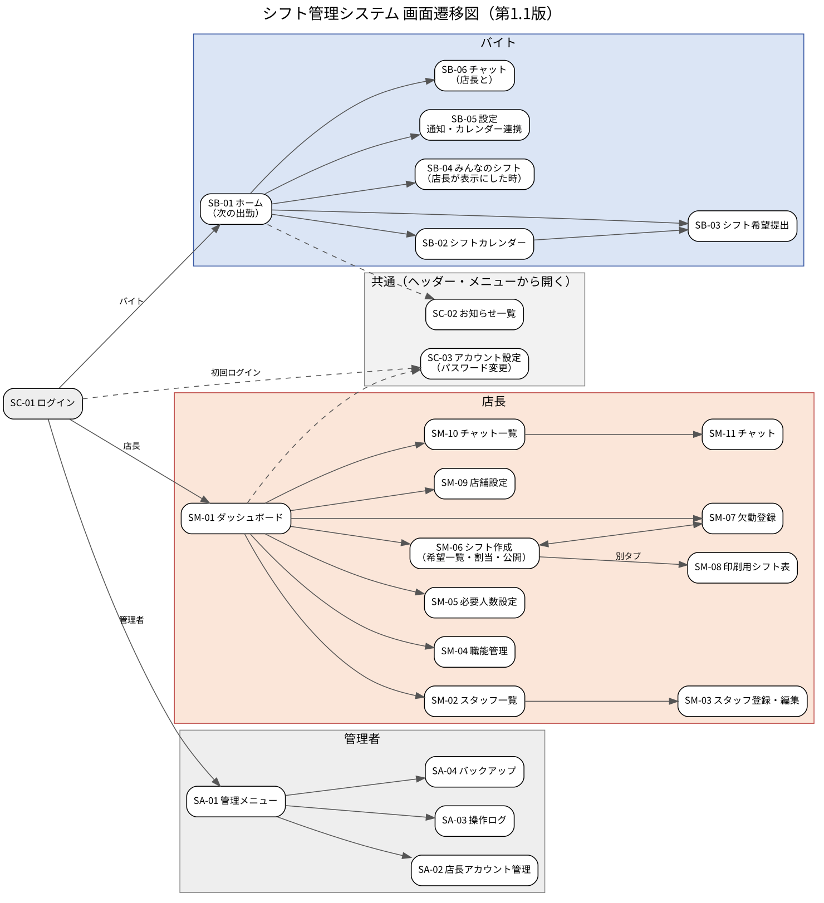
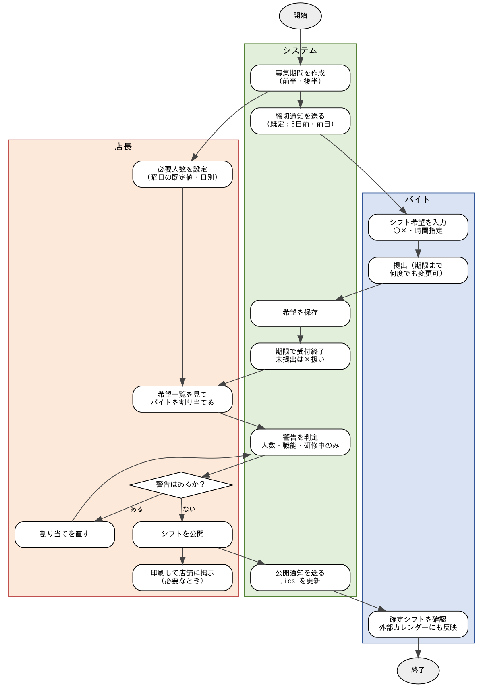
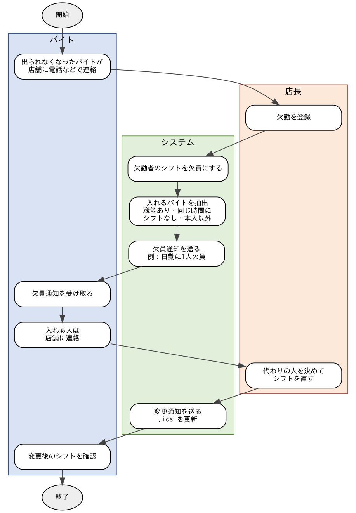

# 10 基本設計書

| 項目 | 内容 |
| --- | --- |
| 文書番号 | 10 |
| 版 | 第1.0版 |
| 作成日 | 令和8年10月21日 |
| 作成 | 企業課題F班（新井・栗原・川端） |
| 対象読者 | 実装を担当するメンバー |
| 元にした資料 | 01_仕様書 第1.2版、02_業務フロー 第1.1版、03_画面遷移図 第1.2版、04_画面レイアウト 第1.2版、05_DB設計 第1.1版、要件定義書 第1.4版 |

## 改版履歴

| 版 | 日付 | 内容 | 作成者 |
| --- | --- | --- | --- |
| 1.0 | 令和8年10月21日 | 初版作成 | 新井 |

---

## 1. この文書の目的と読み方

この文書は、シフト管理システムを「誰が作っても同じものになる」ようにするための土台です。システム全体の構成、使うソフトウェアの版、パッケージ構成、URL、共通のルールを決めます。

- 各画面の細かい動き → `20_詳細設計書/`
- クラス名・メソッド名・引数・戻り値 → `30_クラス設計書/`
- テーブル・列・制約・SQL → `40_DB設計書.md`
- 書き方・Git・メッセージ・セキュリティ・定期処理・環境構築・テスト → `91`〜`97`

**ルール：** 設計書に書いていないことを実装で決めてはいけません。迷ったら実装を止め、新井に確認して設計書を直してから実装します（92_Git運用規約の「設計変更の流れ」）。

### 1.1 用語

| 用語 | 意味 |
| --- | --- |
| 枠 | 日勤枠（8:00〜17:00、☀）と夕勤枠（17:00〜22:00、☾）の2つ。`slots` テーブルの固定2行。 |
| 時間指定 | 枠と違う時間で入るシフト（例：13:00〜22:00）。8:00〜22:00 の範囲、30分単位。 |
| 募集期間 | 毎月の前半（1日〜15日）と後半（16日〜末日）。`shift_periods` の1行。 |
| 提出期限 | 翌月前半分は当月15日 23:59:59、翌月後半分は当月末日 23:59:59。 |
| 希望 | バイトが出す ○（OK）・×（NG）・時間指定（TIME）。`shift_requests`。 |
| 割当 | 店長が決めたシフト。`shift_assignments`。 |
| 公開 | 募集期間の割当をバイトに見せる操作。期間の状態が PUBLISHED になる。 |
| 店長・バイト・管理者 | `users.role` の MANAGER・STAFF・ADMIN。 |

---

## 2. システム構成

### 2.1 全体構成

```
[利用者のブラウザ（PC・タブレット・スマホ）]
        │ HTTP（同じPCからは http://localhost:8080）
        ▼
[Spring Boot アプリ（実行可能JAR、内蔵Tomcat 11）]  ← 新井のPCで課題期間中だけ起動
        │ JDBC（MySQL Connector/J）
        ▼
[MySQL 8.4（サービス名 MySQL84、データベース shift_management）]
```

- 外部カレンダーは、アプリが出す購読用URL（`/ical/{トークン}.ics`）をカレンダーアプリが読みに来る方式です。
  - **注意：** Googleカレンダーの購読は、Googleのサーバーからアプリにアクセスできる必要があります。新井のPCで動かしている間は、インターネットから届かないため、Googleカレンダーには反映されません。課題期間中の確認は、(1) 同じネットワーク内のiPhone・Macの「カレンダー」で購読する、(2) .icsファイルをダウンロードしてGoogleカレンダーに読み込む、のどちらかで行います（97_テスト計画書）。
- メールは使いません。通知はすべてアプリ内のお知らせです。

### 2.2 使うソフトウェアと版（全員この版に合わせる）

新井のPCに入っている版（令和8年10月21日に確認）に合わせました。

| 種類 | 名前 | 版 | 備考 |
| --- | --- | --- | --- |
| JDK | Oracle JDK | 22.0.1 | `java -version` で確認。ほかの版を入れない |
| IDE | Eclipse IDE for Java Developers（Pleiades日本語化） | 2025-12（4.38） | **VS Codeの使用は禁止** |
| Lombok | Eclipseに導入済みのLombok | 1.18.42（Eclipse側） | ビルドで使う版はSpring Bootが決める 1.18.46 |
| ビルド | Maven（Eclipse内蔵 ＋ Maven Wrapper） | Wrapper 3.3.4、Maven 3.9.11 | 単体のMavenは入れない。コマンドで動かすときは `mvnw.cmd` |
| フレームワーク | Spring Boot | 4.1.1 | Spring Framework 7.0.9、Spring Security 7.1.1、Hibernate 7.4.5 |
| 画面 | Thymeleaf | 3.1.5 | Spring Bootが管理する版 |
| 画面部品 | Bootstrap（WebJars） | 5.3.8 | CDNは使わない（オフラインでも動くようにする） |
| DB | MySQL Community Server | 8.4.5 | サービス名 MySQL84 |
| JDBCドライバー | MySQL Connector/J | 9.7.0 | Spring Bootが管理する版 |
| DBの版管理 | Flyway | 12.4.0 | Spring Bootが管理する版 |
| テスト | JUnit | 6.0.3 | Spring Bootが管理する版 |
| カバレッジ | JaCoCo | 0.8.15 | |
| Git | Git for Windows | 2.54 | |

ライブラリの版は `pom.xml`（7章）で固定します。Spring Bootが管理しているライブラリには `<version>` を書きません。

### 2.3 実行のしかた

- 開発中：Eclipseで `ShiftManagementApplication` を右クリック →「実行」→「Spring Boot アプリケーション」がない場合は「Java アプリケーション」。
- 発表・総合テスト：`mvnw.cmd clean package` で `target\shift-management-system-1.0.0-SNAPSHOT.jar` を作り、`java -jar` で起動（96_環境構築手順書）。
- 初回起動時に Flyway がテーブル作成と初期データ投入を自動で行います。

---

## 3. 機能と画面

### 3.1 機能一覧

01_仕様書 第1.2版の機能一覧と同じです（C-02 パスキーは第1.2版で今後の展望へ移したため欠番）。

| 機能ID | 利用者 | 機能名 | 画面ID |
| --- | --- | --- | --- |
| C-01 | 共通 | ログイン・ログアウト | SC-01 |
| C-03 | 共通 | お知らせ | SC-02、ヘッダー |
| C-04 | 共通 | パスワード変更 | SC-03 |
| P-01 | バイト | ホーム（次の出勤） | SB-01 |
| P-02 | バイト | シフトカレンダー | SB-02 |
| P-03 | バイト | シフト希望の提出 | SB-03 |
| P-04 | バイト | みんなのシフト | SB-04 |
| P-05 | バイト | 外部カレンダー連携 | SB-05、購読URL（IC-01） |
| P-06 | バイト | 通知の設定 | SB-05 |
| P-07 | バイト | チャット | SB-06 |
| M-01 | 店長 | ダッシュボード | SM-01 |
| M-02 | 店長 | スタッフ管理 | SM-02、SM-03 |
| M-03 | 店長 | 職能管理 | SM-04 |
| M-04 | 店長 | 必要人数の設定 | SM-05 |
| M-05 | 店長 | シフト作成 | SM-06、SM-06-1 |
| M-06 | 店長 | シフト公開 | SM-06 |
| M-07 | 店長 | 欠勤登録・欠員通知 | SM-07 |
| M-08 | 店長 | タイムスケジュール印刷 | SM-08 |
| M-09 | 店長 | 店舗の設定 | SM-09 |
| M-10 | 店長 | チャット | SM-10、SM-11 |
| A-01 | 管理者 | 店長アカウント管理 | SA-02 |
| A-02 | 管理者 | 操作ログの確認 | SA-03 |
| A-03 | 管理者 | バックアップ | SA-04 |
| －（定期処理） | システム | 募集期間の作成・締切・締切通知 | BT-01〜BT-03（95_通知・定期処理設計書） |

### 3.2 画面一覧とURL

03_画面遷移図 第1.2版の画面に、仕様書4.1(4)「期限後は店長が代わりに直す」ための **SM-06-1 希望の代理修正** を加えました。

| 画面ID | 画面名 | 利用者 | URL（GET） | テンプレート | コントローラー |
| --- | --- | --- | --- | --- | --- |
| SC-01 | ログイン | 全員 | `/login` | `common/login.html` | `LoginController` |
| SC-02 | お知らせ一覧 | 全員 | `/notices` | `common/notices.html` | `NoticeController` |
| SC-03 | アカウント設定（パスワード変更） | 全員 | `/account/password` | `common/account-password.html` | `AccountController` |
| SB-01 | ホーム（次の出勤） | バイト | `/staff/home` | `staff/home.html` | `StaffHomeController` |
| SB-02 | シフトカレンダー | バイト | `/staff/shifts` | `staff/shifts.html` | `StaffShiftController` |
| SB-03 | シフト希望提出 | バイト | `/staff/requests` | `staff/requests.html` | `StaffRequestController` |
| SB-04 | みんなのシフト | バイト | `/staff/all-shifts` | `staff/all-shifts.html` | `StaffShiftController` |
| SB-05 | 設定（通知・カレンダー連携） | バイト | `/staff/settings` | `staff/settings.html` | `StaffSettingController` |
| SB-06 | チャット（店長と） | バイト | `/staff/chat` | `staff/chat.html` | `StaffChatController` |
| SM-01 | ダッシュボード | 店長 | `/manager/home` | `manager/home.html` | `ManagerHomeController` |
| SM-02 | スタッフ一覧 | 店長 | `/manager/staff` | `manager/staff-list.html` | `ManagerStaffController` |
| SM-03 | スタッフ登録・編集 | 店長 | `/manager/staff/new`、`/manager/staff/{id}` | `manager/staff-form.html` | `ManagerStaffController` |
| SM-04 | 職能管理 | 店長 | `/manager/skills` | `manager/skills.html` | `ManagerSkillController` |
| SM-05 | 必要人数設定 | 店長 | `/manager/required` | `manager/required.html` | `ManagerRequiredStaffController` |
| SM-06 | シフト作成（希望一覧・割当・公開） | 店長 | `/manager/periods/{id}` | `manager/period.html` | `ManagerPeriodController` |
| SM-06-1 | 希望の代理修正 | 店長 | `/manager/periods/{id}/requests/{userId}` | `manager/request-proxy.html` | `ManagerPeriodController` |
| SM-07 | 欠勤登録 | 店長 | `/manager/absences` | `manager/absence.html` | `ManagerAbsenceController` |
| SM-08 | 印刷用シフト表 | 店長 | `/manager/periods/{id}/print` | `manager/print.html` | `ManagerPeriodController` |
| SM-09 | 店舗設定 | 店長 | `/manager/settings` | `manager/settings.html` | `ManagerSettingController` |
| SM-10 | チャット一覧 | 店長 | `/manager/chats` | `manager/chat-list.html` | `ManagerChatController` |
| SM-11 | チャット（バイトごと） | 店長 | `/manager/chats/{staffId}` | `manager/chat.html` | `ManagerChatController` |
| SA-01 | 管理メニュー | 管理者 | `/admin/home` | `admin/home.html` | `AdminHomeController` |
| SA-02 | 店長アカウント管理 | 管理者 | `/admin/managers` | `admin/managers.html` | `AdminManagerController` |
| SA-03 | 操作ログ | 管理者 | `/admin/logs` | `admin/logs.html` | `AdminLogController` |
| SA-04 | バックアップ | 管理者 | `/admin/backups` | `admin/backups.html` | `AdminBackupController` |
| IC-01 | カレンダー購読（画面なし） | 外部カレンダー | `/ical/{token}.ics` | なし（テキストを返す） | `CalendarFeedController` |
| ER-01 | エラー（404） | 全員 | － | `error/404.html` | `GlobalExceptionHandler` |
| ER-02 | エラー（500） | 全員 | － | `error/500.html` | `GlobalExceptionHandler` |

POST のURLは各画面の詳細設計書に書きます。URLの一覧は付録Aにまとめています。

### 3.3 画面遷移



- ログイン後の最初の画面：バイト→SB-01、店長→SM-01、管理者→SA-01（`HomeUrl.of(role)`）。
- `must_change_password = TRUE` の人は、SC-03 とログアウト以外を開けない（`PasswordChangeRequiredFilter`）。
- 権限のないURLを開いたら自分のホームへリダイレクト（`HomeRedirectAccessDeniedHandler`）。ログインしていなければ `/login` へ。
- `/` を開いたら、ログイン済みならホーム、未ログインなら `/login`。

### 3.4 業務フロー





---

## 4. アーキテクチャ

### 4.1 層の分け方

Controller → Service → Repository の3層です。

| 層 | パッケージ | 役割 | してはいけないこと |
| --- | --- | --- | --- |
| Controller | `controller.*` | URLを受け、フォームの入力チェック結果を見て、Serviceを呼び、画面名かリダイレクト先を返す | Repositoryを直接呼ぶ。業務ルールを書く。`@Transactional` を付ける |
| Service | `service` | 業務ルール・トランザクション。1画面操作＝1メソッドを基本にする | `HttpServletRequest` や `Model` を受け取る |
| Repository | `repository` | DBアクセス（Spring Data JPA） | 業務ルールを書く |
| Entity | `entity` | テーブルと1対1のクラス | 画面にそのまま渡して編集させる（表示には渡してよい） |
| Form | `form` | 画面から受け取る値と入力チェック | Serviceより下に渡さない（Serviceへは値を取り出して渡す。例外は 30-00 4章に書いた Service だけ） |
| DTO | `dto` | 画面に表示するためにまとめた値（`record`） | － |

### 4.2 パッケージ構成

ベースパッケージは `jp.numajo.fgroup.shift` です。

```
src/main/java/jp/numajo/fgroup/shift/
├── ShiftManagementApplication.java   起動クラス
├── config/        設定（SecurityConfig、ClockConfig、AppProperties）
├── constant/      列挙型（Role、Availability、RequestMode、PeriodStatus、AssignmentStatus、NotificationType、BackupStatus、WarningType、OperationAction、StaffStatusFilter、BadgeType）と定数クラス SlotIds
├── controller/
│   ├── common/    SC系・IC-01・共通の ControllerAdvice
│   ├── staff/     SB系
│   ├── manager/   SM系
│   └── admin/     SA系
├── dto/           表示用のレコード
├── entity/        エンティティ
│   └── id/        複合主キー
├── exception/     例外と例外ハンドラー
├── form/          入力フォーム
├── repository/    リポジトリ
├── scheduler/     定期処理
├── security/      ログイン・権限まわり
├── service/       業務ロジック
└── util/          日付・時刻・文字列の共通処理

src/main/resources/
├── application.yml
├── messages.properties          メッセージ（93_メッセージ一覧）
├── db/migration/                Flyway（V1__create_tables.sql、V2__insert_initial_data.sql）
├── static/css/app.css
├── static/js/app.js
├── static/images/logo.png       ※リポジトリには入れない（5.4）
└── templates/
    ├── layout/base.html          共通レイアウト（ヘッダー・メニューあり）
    ├── layout/plain.html         ヘッダー・メニューなし（SC-01・SM-08・エラー画面）
    ├── fragments/                ヘッダー・メニュー・メッセージ・シフトバッジ
    ├── common/ staff/ manager/ admin/ error/
```

クラスの一覧と中身は 30_クラス設計書 に書きます。

### 4.3 リクエストの流れ（例：SB-03 希望の提出）

1. ブラウザが `POST /staff/requests` を送る（CSRFトークン付き）。
2. Spring Security がログインと権限（ROLE_STAFF）を確認する。
3. `StaffRequestController#submit` が `ShiftRequestForm` を受け取り、`@Validated` の結果を見る。エラーがあれば画面を再表示する。
4. `ShiftRequestService#submit(userId, form値)` を呼ぶ。期限・職能・時刻をチェックし、`shift_requests` を入れ替え、`request_submissions` を更新する（1トランザクション）。
5. 業務エラー（`BusinessException`）なら、コントローラーがメッセージをフラッシュ属性に入れて同じ画面へリダイレクトする。
6. 成功したら `redirect:/staff/requests?periodId={id}` とし、完了メッセージ（I1302）を出す（PRGパターン）。

---

## 5. 共通の決まり

### 5.1 画面の共通部品

- すべての画面は `layout/base.html` を使います（Thymeleaf Layout Dialect）。SC-01・SM-08・エラー画面だけはヘッダーとメニューなしの `layout/plain.html` を使います。
- ヘッダー：ロゴ、システム名「シフト管理システム」、店舗名（`store_settings.store_name`）、お知らせ（🔔＋未読数。0件なら数字を出さない）、名前、ログアウトボタン。
- メニュー：利用者の種類ごとの項目（20-00_詳細設計の共通ルール 3章）。一番上に役割ラベル（バイト＝緑、店長＝オレンジ、管理者＝灰）。
- ヘッダーとメニューに必要な値（未読数・店舗名・ほかの人のシフト表示）は `GlobalModelAdvice` がすべての画面に入れます。
- メッセージ表示：成功（緑）・警告（黄）・エラー（赤）のアラートを本文の一番上に出します（`fragments/messages.html`）。

### 5.2 画面の作り方の決まり

- 画面の更新は必ず POST → リダイレクト → GET（PRG）。POSTのあとに直接テンプレートを返すのは、入力チェックエラーで画面を再表示するときだけ。
- すべてのPOSTフォームは `th:action` を使い、CSRFトークンを自動で入れます。リンク（`<a>`）で更新処理をしてはいけません。
- 削除・公開・パスワード初期化など取り消せない操作は、ボタンに `data-confirm="（確認文）"` を付け、`app.js` が確認ダイアログを出します。
- JavaScriptは `static/js/app.js` の1ファイルだけ。使ってよいのは次の表の動きだけです。Ajax（fetch）は使いません。

| 目印 | 動き | 使う画面 |
| --- | --- | --- |
| `data-confirm="（確認文）"` | 送信の前に確認ダイアログを出し、「キャンセル」なら送らない | 取り消せない操作のボタン全部 |
| `data-copy-target="（入力欄のid）"` | 入力欄の文字をクリップボードにコピーし、ボタンの文字を2秒間「コピーしました」にする | SB-05 |
| `data-auto-submit` | プルダウン・日付を変えたら、そのGETフォームを送信する | SB-02、SB-03、SB-04、SM-07 |
| `data-auto-navigate="（URLの前半）"` | プルダウンを変えたら、`URLの前半＋選んだ値` へ移動する | SM-06（`/manager/periods/`） |
| `data-fill="OK"`／`data-fill="NG"` | 「全部○」「全部×」：SLOT の日の、使えるラジオをすべてチェックする | SB-03、SM-06-1 |
| `.js-mode-radio` | 「時間指定」を選んだ日は時刻のプルダウンを出して○×を使えなくし、「枠ごと」に戻したら逆にする | SB-03、SM-06-1 |
| `data-print` | `window.print()` を呼ぶ | SM-08 |
| `data-close` | `window.close()` を呼ぶ | SM-08 |
| `data-once` | 押したらボタンを `disabled` にして「作成中…」と表示する（二重送信の防止） | SA-04 |
| （Bootstrap の `data-bs-toggle`） | スマホのメニューの開閉 | 全画面 |
- レスポンシブ：Bootstrap 5 のグリッドを使い、ブレークポイントは 768px（md）と 1024px（`app.css` で定義）。

### 5.3 日付・時刻

- タイムゾーンは Asia/Tokyo 固定。現在日時は必ず `Clock` から取ります（`LocalDateTime.now(clock)`）。`LocalDateTime.now()` を直接書いてはいけません（テストで日時を固定するため）。
- 画面の表示形式（`DateTimeUtil`）：

| 用途 | 形式 | 例 |
| --- | --- | --- |
| 日付（月日と曜日） | `M月d日(E)` | 10月24日(土) |
| 日付（年月日） | `yyyy年M月d日` | 2026年10月24日 |
| 日時 | `yyyy/MM/dd HH:mm` | 2026/10/31 23:59 |
| 時刻 | `H:mm` | 8:00、13:30 |
| 募集期間 | `M/d〜M/d` | 11/1〜11/15 |
| 時間指定のバッジ | `H-H` または `H:mm-H:mm` | 13-22、13:30-22 |

- 入力の形式：日付は `<input type="date">`（`yyyy-MM-dd`）、時刻はプルダウン（8:00〜22:00 の30分刻み、値は `HH:mm`）。

### 5.4 ロゴとリポジトリ

- セブン-イレブンのロゴは企業から使用許可をもらっていますが、このGitHubリポジトリは公開（public）なので、**ロゴ画像はリポジトリに入れません。** 各自 `D:\2026沼情\後期\企業課題\7eleven.webp` をPNGに変換し、`src/main/resources/static/images/logo.png` として置きます（`.gitignore` で除外済み）。
- `logo.png` がないときは、ヘッダーにロゴの代わりに何も出さない（`` の `onerror` で非表示）。

### 5.5 エラー処理

| 種類 | 例外クラス | 画面の動き |
| --- | --- | --- |
| 入力チェックエラー | （BindingResult） | 同じ画面を再表示し、項目の下に赤字でメッセージ |
| 業務エラー | `BusinessException` | 同じ画面へリダイレクトし、上部に赤のアラート |
| 対象が見つからない | `ResourceNotFoundException` | ER-01（404） |
| 権限がない | （Spring Security） | 自分のホームへリダイレクト |
| 予期しないエラー | その他の例外 | ER-02（500）。ログに ERROR で出す |

### 5.6 ログ

- アプリのログ：SLF4J（`@Slf4j`）。INFO 以上を標準出力。`jp.numajo.fgroup.shift` は開発中 DEBUG。
- 操作ログ（`operation_logs`）：誰が何をしたかを残します。記録する操作は 94_セキュリティ設計書 4章の一覧のとおり。`OperationLogService#record` を Service の中から呼びます。

### 5.7 メッセージ

- 画面に出す文はすべて `messages.properties` に置き、コードで呼びます（`E` エラー、`W` 警告、`I` 情報）。一覧は 93_メッセージ一覧。
- Javaのコードやテンプレートに日本語のメッセージ文を直接書いてはいけません（画面の見出し・項目名・ボタン名はテンプレートに直接書いてよい）。

---

## 6. 業務ルールの実装方針（全画面共通）

01_仕様書 第4章を、実装の言葉に直したものです。詳しい手順は各詳細設計書にあります。

### 6.1 募集期間

- 期間は自動で作ります（BT-01）。毎日 0:05 と起動時に、「今月」と「来月」の前半・後半の4期間がなければ作ります。作るときにすでに期限を過ぎている期間は、最初から CLOSED で作ります（95_通知・定期処理設計書 2.2）。
- 期限：開始日がM月1日の期間 → (M−1)月15日 23:59:59。開始日がM月16日の期間 → (M−1)月の末日 23:59:59。
- 状態：OPEN（受付中）→ 期限を過ぎたら CLOSED（作成中）（BT-02、毎日 0:00:30 と起動時）→ 店長が公開したら PUBLISHED（公開済み）。PUBLISHED から戻すことはない。
- 期限の判定は、状態だけでなく必ず `now <= deadline_at` でも確認します（BT-02 が動く前の0:00〜0:00:30に提出されても受け付けないため）。

### 6.2 希望の提出

- 1日ごとに「枠ごとに○×」か「時間指定」のどちらかを選びます。
- 枠ごと：自分が職能を持っている枠すべてに○か×を付けないと提出できません。職能のない枠は選べず、保存もしません（×と同じ扱い）。
- 時間指定：開始＜終了、8:00〜22:00、30分単位。職能のない枠と1分でも重なる時間は指定できません。
- 提出すると、その期間の自分の希望を全部消してから入れ直し、`request_submissions` に提出日時を入れます。「提出を取り消す」で希望と提出日時を消します。どちらも期限内だけ。
- 未提出（`request_submissions` に行がない）は全部×として扱います。

### 6.3 割当と警告

- 割当を編集できるのは、期間が CLOSED か PUBLISHED のとき。
- 同じ人・同じ日に、時間が重なる「出勤（ASSIGNED）」の割当を2つ作ってはいけません。
- 枠の人数：その日の割当（ASSIGNED）のうち、時間が枠と重なるものの数。時間指定（例：13-22）は日勤・夕勤の両方に数えます。
- 必要人数：日付ごとの上書き（`required_staff_overrides`）があればそれ、なければ曜日の既定値（`required_staff_defaults`）。
- 警告は3種類（`WarningType`）：

| 種類 | 条件 | 公開 |
| --- | --- | --- |
| 人数不足（SHORTAGE） | 枠の人数 ＜ 必要人数 | できる |
| 職能不足（SKILL） | 枠と重なる割当の人が、その枠の必要職能のどれかを持っていない | できる |
| 研修中のみ（TRAINEE_ONLY） | 枠の人数 ≧ 1 で、全員が研修中 | **できない** |

- 公開後に割当を変えたら、変わったバイトにお知らせ（CHANGED）を送ります。

### 6.4 欠勤

- 店長が公開済み期間の割当を選んで欠勤登録します。割当の状態を ABSENT にし、`absences` に1行入れます。
- 欠員通知の相手：有効なバイトのうち、本人以外で、その枠（時間指定なら重なる全枠）の必要職能をすべて持ち、その日に時間が重なる出勤の割当がない人。研修中の人も含みます。
- 代わりの人は、店長が SM-06 で普通に割り当てます。

### 6.5 通知

| 種類 | いつ | 誰に | 件名（93_メッセージ一覧の N 系） |
| --- | --- | --- | --- |
| DEADLINE | 毎日9:00（BT-03） | 期限まで 0・1・3・7 日のうち本人が選んだ日で、未提出の有効なバイト | N0001 |
| PUBLISHED | 公開したとき | 有効なバイト全員 | N0002 |
| CHANGED | 公開後に割当を追加・削除・欠勤登録したとき | 変わったバイト本人 | N0003 |
| VACANCY | 欠勤登録したとき | 欠員通知の相手 | N0004 |
| CHAT | チャットを送ったとき | 相手（バイトが送ったら有効な店長全員） | N0005 |

---

## 7. ビルドの設定（pom.xml）

次の内容から変えてはいけません。依存を足すときは設計書を先に直します。

あわせて、プロジェクトの一番上（`pom.xml` と同じ場所）に `lombok.config` を置きます（Lombok が作ったメソッドを JaCoCo のカバレッジから外すため。97_テスト計画書 2.2）。

```properties
# Lombok の設定（97_テスト計画書 2.2）
config.stopBubbling = true
lombok.addLombokGeneratedAnnotation = true
```

`pom.xml` は次のとおりです。

```xml
<?xml version="1.0" encoding="UTF-8"?>
<project xmlns="http://maven.apache.org/POM/4.0.0"
         xmlns:xsi="http://www.w3.org/2001/XMLSchema-instance"
         xsi:schemaLocation="http://maven.apache.org/POM/4.0.0 https://maven.apache.org/xsd/maven-4.0.0.xsd">
    <modelVersion>4.0.0</modelVersion>

    <parent>
        <groupId>org.springframework.boot</groupId>
        <artifactId>spring-boot-starter-parent</artifactId>
        <version>4.1.1</version>
        <relativePath/>
    </parent>

    <groupId>jp.numajo.fgroup</groupId>
    <artifactId>shift-management-system</artifactId>
    <version>1.0.0-SNAPSHOT</version>
    <name>shift-management-system</name>
    <description>シフト管理システム</description>

    <properties>
        <java.version>22</java.version>
        <project.build.sourceEncoding>UTF-8</project.build.sourceEncoding>
        <bootstrap.version>5.3.8</bootstrap.version>
        <jacoco.version>0.8.15</jacoco.version>
    </properties>

    <dependencies>
        <dependency>
            <groupId>org.springframework.boot</groupId>
            <artifactId>spring-boot-starter-webmvc</artifactId>
        </dependency>
        <dependency>
            <groupId>org.springframework.boot</groupId>
            <artifactId>spring-boot-starter-thymeleaf</artifactId>
        </dependency>
        <dependency>
            <groupId>org.springframework.boot</groupId>
            <artifactId>spring-boot-starter-security</artifactId>
        </dependency>
        <dependency>
            <groupId>org.springframework.boot</groupId>
            <artifactId>spring-boot-starter-data-jpa</artifactId>
        </dependency>
        <dependency>
            <groupId>org.springframework.boot</groupId>
            <artifactId>spring-boot-starter-validation</artifactId>
        </dependency>
        <dependency>
            <groupId>org.springframework.boot</groupId>
            <artifactId>spring-boot-starter-flyway</artifactId>
        </dependency>
        <dependency>
            <groupId>org.flywaydb</groupId>
            <artifactId>flyway-mysql</artifactId>
        </dependency>
        <dependency>
            <groupId>org.thymeleaf.extras</groupId>
            <artifactId>thymeleaf-extras-springsecurity6</artifactId>
        </dependency>
        <dependency>
            <groupId>nz.net.ultraq.thymeleaf</groupId>
            <artifactId>thymeleaf-layout-dialect</artifactId>
        </dependency>
        <dependency>
            <groupId>org.webjars</groupId>
            <artifactId>bootstrap</artifactId>
            <version>${bootstrap.version}</version>
        </dependency>
        <dependency>
            <groupId>org.webjars</groupId>
            <artifactId>webjars-locator-lite</artifactId>
        </dependency>
        <dependency>
            <groupId>com.mysql</groupId>
            <artifactId>mysql-connector-j</artifactId>
            <scope>runtime</scope>
        </dependency>
        <dependency>
            <groupId>org.projectlombok</groupId>
            <artifactId>lombok</artifactId>
            <optional>true</optional>
        </dependency>
        <dependency>
            <groupId>org.springframework.boot</groupId>
            <artifactId>spring-boot-devtools</artifactId>
            <scope>runtime</scope>
            <optional>true</optional>
        </dependency>

        <dependency>
            <groupId>org.springframework.boot</groupId>
            <artifactId>spring-boot-starter-test</artifactId>
            <scope>test</scope>
        </dependency>
        <dependency>
            <groupId>org.springframework.boot</groupId>
            <artifactId>spring-boot-starter-webmvc-test</artifactId>
            <scope>test</scope>
        </dependency>
        <dependency>
            <groupId>org.springframework.boot</groupId>
            <artifactId>spring-boot-starter-security-test</artifactId>
            <scope>test</scope>
        </dependency>
        <dependency>
            <groupId>org.springframework.boot</groupId>
            <artifactId>spring-boot-starter-data-jpa-test</artifactId>
            <scope>test</scope>
        </dependency>
    </dependencies>

    <build>
        <plugins>
            <plugin>
                <groupId>org.apache.maven.plugins</groupId>
                <artifactId>maven-compiler-plugin</artifactId>
                <configuration>
                    <annotationProcessorPaths>
                        <path>
                            <groupId>org.projectlombok</groupId>
                            <artifactId>lombok</artifactId>
                        </path>
                    </annotationProcessorPaths>
                </configuration>
            </plugin>
            <plugin>
                <groupId>org.springframework.boot</groupId>
                <artifactId>spring-boot-maven-plugin</artifactId>
                <configuration>
                    <excludes>
                        <exclude>
                            <groupId>org.projectlombok</groupId>
                            <artifactId>lombok</artifactId>
                        </exclude>
                    </excludes>
                </configuration>
            </plugin>
            <plugin>
                <groupId>org.jacoco</groupId>
                <artifactId>jacoco-maven-plugin</artifactId>
                <version>${jacoco.version}</version>
                <executions>
                    <execution>
                        <id>prepare-agent</id>
                        <goals><goal>prepare-agent</goal></goals>
                    </execution>
                    <execution>
                        <id>report</id>
                        <phase>test</phase>
                        <goals><goal>report</goal></goals>
                    </execution>
                </executions>
            </plugin>
        </plugins>
    </build>
</project>
```

**確認済み：** この pom.xml と 40_DB設計書のFlywayスクリプト、94_セキュリティ設計書のログイン処理は、令和8年10月21日に検証用プロジェクトでビルドとテスト（75件）を通しています（97_テスト計画書 2.3）。検証環境の都合で JDK 21・MariaDB で確認したため、各自のPC（JDK 22・MySQL 8.4）で初回起動したときにエラーが出ないことを 96_環境構築手順書 の手順で確認してください。

---

## 8. 設定ファイル（application.yml）

```yaml
# シフト管理システム 設定ファイル（10_基本設計書 8章）
spring:
  application:
    name: shift-management-system
  datasource:
    url: jdbc:mysql://localhost:3306/shift_management?connectionTimeZone=%2B09:00&forceConnectionTimeZoneToSession=true&characterEncoding=UTF-8
    username: shift_app
    password: ${DB_PASSWORD}
  jpa:
    open-in-view: false
    hibernate:
      ddl-auto: validate
    properties:
      hibernate:
        jdbc:
          time_zone: Asia/Tokyo
  flyway:
    enabled: true
    locations: classpath:db/migration
  thymeleaf:
    cache: false
  messages:
    basename: messages
    encoding: UTF-8
  jackson:
    time-zone: Asia/Tokyo
server:
  port: 8080
  servlet:
    session:
      timeout: 30m
logging:
  level:
    root: INFO
    jp.numajo.fgroup.shift: DEBUG
app:
  base-url: http://localhost:8080
  backup:
    mysqldump-path: "C:/Program Files/MySQL/MySQL Server 8.4/bin/mysqldump.exe"
    dir: "C:/shift-management/backup"
    timeout-seconds: 120
```

- タイムゾーン：JDBC の接続は `connectionTimeZone=%2B09:00` と `forceConnectionTimeZoneToSession=true` で日本時間（+09:00）に固定します。`Asia/Tokyo` と書かないのは、MySQL にタイムゾーンの表（`mysql_tzinfo_to_sql`）が入っていないと接続に失敗するためです。あわせて起動クラスの `static` ブロックで `TimeZone.setDefault(TimeZone.getTimeZone("Asia/Tokyo"))` を呼びます（30-01。JVM が日本時間でない環境で、時刻が9時間ずれて CHECK 制約に違反するのを防ぐため。検証で実際に起きた）。
- DBのパスワードは環境変数 `DB_PASSWORD` で渡します（Eclipseでは「実行の構成」→「環境」タブ）。ファイルに書いてはいけません。
- `app.*` は `AppProperties`（`@ConfigurationProperties(prefix = "app")`）で読みます。
- `app.base-url` は購読URLの組み立てに使います。スマホから使うときは、新井のPCのIPアドレス（例：`http://192.168.1.10:8080`）に変えます。
- `app.backup.dir` は仕様書の「新井のPCの決めたフォルダ」です。フォルダは事前に作っておきます。
- テスト用は `src/test/resources/application-test.yml` で、DBを `shift_test` に変えます（97_テスト計画書）。

---

## 9. 非機能

| 項目 | 決め事 | 確認方法 |
| --- | --- | --- |
| 性能 | 利用者20人程度で、各画面の表示が3秒以内 | 総合テストで、SM-06（31日×2枠×20人）の表示時間を計る |
| 端末 | PC（1024px以上）、タブレット（768〜1023px）、スマホ（767px以下） | Chromeの開発者ツールで3つの幅を確認 |
| ブラウザ | Chrome・Edge・Safari（最新版） | 総合テスト |
| セキュリティ | 94_セキュリティ設計書 | 単体・結合テスト |
| セッション | 30分操作がなければログアウト | 結合テスト |
| バックアップ | 管理者がSA-04で作成。目安は週1回とシフト公開の前 | 運用 |

---

## 付録A URL一覧（POSTを含む）

| メソッド | URL | 画面 | 処理 | 権限 |
| --- | --- | --- | --- | --- |
| GET | `/` | － | ホームかログインへリダイレクト | 全員 |
| GET | `/login` | SC-01 | ログイン画面 | 未ログイン |
| POST | `/login` | SC-01 | ログイン（Spring Security） | 未ログイン |
| POST | `/logout` | 全画面 | ログアウト | ログイン済み |
| GET | `/notices` | SC-02 | お知らせ一覧 | ログイン済み |
| POST | `/notices/{id}/open` | SC-02 | 既読にしてリンク先へ | ログイン済み |
| POST | `/notices/read-all` | SC-02 | すべて既読 | ログイン済み |
| GET | `/account/password` | SC-03 | パスワード変更画面 | ログイン済み |
| POST | `/account/password` | SC-03 | パスワード変更 | ログイン済み |
| GET | `/ical/{token}.ics` | IC-01 | 購読用カレンダー | だれでも（トークンで判定） |
| GET | `/staff/home` | SB-01 | ホーム | STAFF |
| GET | `/staff/shifts` | SB-02 | シフトカレンダー | STAFF |
| GET | `/staff/requests` | SB-03 | 希望提出画面 | STAFF |
| POST | `/staff/requests` | SB-03 | 希望の提出 | STAFF |
| POST | `/staff/requests/cancel` | SB-03 | 提出の取り消し | STAFF |
| GET | `/staff/all-shifts` | SB-04 | みんなのシフト | STAFF |
| GET | `/staff/settings` | SB-05 | 設定画面 | STAFF |
| POST | `/staff/settings/notifications` | SB-05 | 締切通知の保存 | STAFF |
| POST | `/staff/settings/calendar/reissue` | SB-05 | 購読URLの再発行 | STAFF |
| GET | `/staff/chat` | SB-06 | チャット | STAFF |
| POST | `/staff/chat` | SB-06 | メッセージ送信 | STAFF |
| GET | `/manager/home` | SM-01 | ダッシュボード | MANAGER |
| GET | `/manager/staff` | SM-02 | スタッフ一覧 | MANAGER |
| GET | `/manager/staff/new` | SM-03 | 登録画面 | MANAGER |
| POST | `/manager/staff` | SM-03 | 登録 | MANAGER |
| GET | `/manager/staff/{id}` | SM-03 | 編集画面 | MANAGER |
| POST | `/manager/staff/{id}` | SM-03 | 更新 | MANAGER |
| POST | `/manager/staff/{id}/reset-password` | SM-03 | パスワード初期化 | MANAGER |
| GET | `/manager/skills` | SM-04 | 職能管理 | MANAGER |
| POST | `/manager/skills` | SM-04 | 職能の追加 | MANAGER |
| POST | `/manager/skills/{id}` | SM-04 | 職能の変更 | MANAGER |
| POST | `/manager/skills/{id}/delete` | SM-04 | 職能の削除 | MANAGER |
| POST | `/manager/skills/slot-required` | SM-04 | 枠の必要職能の保存 | MANAGER |
| GET | `/manager/required` | SM-05 | 必要人数設定 | MANAGER |
| POST | `/manager/required/defaults` | SM-05 | 曜日の既定値の保存 | MANAGER |
| POST | `/manager/required/overrides` | SM-05 | 日付ごとの上書きの保存 | MANAGER |
| POST | `/manager/required/overrides/delete` | SM-05 | 上書きの削除 | MANAGER |
| GET | `/manager/periods` | SM-06 | 今日に近い期間へリダイレクト | MANAGER |
| GET | `/manager/periods/{id}` | SM-06 | シフト作成 | MANAGER |
| POST | `/manager/periods/{id}/assignments/toggle` | SM-06 | 枠の割当の切替 | MANAGER |
| POST | `/manager/periods/{id}/assignments/time` | SM-06 | 時間指定の割当 | MANAGER |
| POST | `/manager/periods/{id}/assignments/{assignmentId}/delete` | SM-06 | 割当の削除 | MANAGER |
| POST | `/manager/periods/{id}/publish` | SM-06 | 公開 | MANAGER |
| GET | `/manager/periods/{id}/requests/{userId}` | SM-06-1 | 代理修正画面 | MANAGER |
| POST | `/manager/periods/{id}/requests/{userId}` | SM-06-1 | 代理修正の保存 | MANAGER |
| GET | `/manager/periods/{id}/print` | SM-08 | 印刷用シフト表 | MANAGER |
| GET | `/manager/absences` | SM-07 | 欠勤登録画面 | MANAGER |
| POST | `/manager/absences` | SM-07 | 欠勤登録と通知 | MANAGER |
| GET | `/manager/settings` | SM-09 | 店舗設定 | MANAGER |
| POST | `/manager/settings` | SM-09 | 店舗設定の保存 | MANAGER |
| GET | `/manager/chats` | SM-10 | チャット一覧 | MANAGER |
| GET | `/manager/chats/{staffId}` | SM-11 | チャット | MANAGER |
| POST | `/manager/chats/{staffId}` | SM-11 | メッセージ送信 | MANAGER |
| GET | `/admin/home` | SA-01 | 管理メニュー | ADMIN |
| GET | `/admin/managers` | SA-02 | 店長アカウント一覧 | ADMIN |
| POST | `/admin/managers` | SA-02 | 店長アカウント作成 | ADMIN |
| POST | `/admin/managers/{id}/stop` | SA-02 | 停止 | ADMIN |
| POST | `/admin/managers/{id}/resume` | SA-02 | 再開 | ADMIN |
| POST | `/admin/managers/{id}/reset-password` | SA-02 | パスワード初期化 | ADMIN |
| GET | `/admin/logs` | SA-03 | 操作ログ | ADMIN |
| GET | `/admin/backups` | SA-04 | バックアップ | ADMIN |
| POST | `/admin/backups` | SA-04 | バックアップ作成 | ADMIN |
