# 11 データフロー図（DFD）

| 項目 | 内容 |
| --- | --- |
| 文書番号 | 11 |
| 版 | 第1.1版（令和8年11月24日） |
| 作成日 | 令和8年11月24日 |
| 作成 | 企業課題F班（新井・栗原・川端） |
| 対象読者 | 班員（実装・テストの担当）と、評価をする先生 |
| 元にした資料 | 10_基本設計書 第1.4版、20_詳細設計書（各画面）、30-05_service、40_DB設計書 第1.2版、95_通知・定期処理設計書、令和8年11月24日時点の main のソースコード |

## 改版履歴

| 版 | 日付 | 内容 | 作成者 |
| --- | --- | --- | --- |
| 1.0 | 令和8年11月24日 | 初版作成（コンテキスト図、レベル0、レベル1（11プロセス）） | 新井 |
| 1.1 | 令和8年11月24日 | PR #87（SM-01 ダッシュボード）のマージを受けて、5.7 と7章の「マージ待ち」の記述を直し、7.4 ダッシュボードに D3 シフト枠を読む線を足した | 新井 |

---

## 1. この文書の目的と読み方

シフト管理システムの中で、**どのデータが、どこから来て、どこで加工され、どこに保存され、どこへ出ていくか**を図にしたものです。画面遷移図（10_基本設計書 3.3）は「画面の順番」、ER図（40_DB設計書）は「データの形」を表しますが、この文書は「データの流れ」を表します。

- 3章のコンテキスト図で、システムと外の世界（人・カレンダーアプリなど）のやり取りをつかみます。
- 4章のレベル0で、システムの中を11の処理（プロセス）に分けて、どの処理がどのデータストア（テーブル）を読み書きするかを見ます。
- 5章のレベル1で、各プロセスを画面・Service のメソッドの単位まで分けます。テストのときに「この操作でどのテーブルが変わるか」を確かめるのにも使えます。

### 1.1 記号

図は GitHub 上でそのまま見られるように Mermaid で書いています。Mermaid には DFD の記号がないので、近い形で代わりにしています。印刷・提出用には、教科書どおりの記号で描いた PNG 画像（`images/DFD/`）もあります（6章）。

| 要素 | 意味 | Mermaid の図 | PNG の図 |
| --- | --- | --- | --- |
| 外部実体 | システムの外にいて、データを出したり受け取ったりするもの（人・ほかのシステム） | 四角 `E1 バイト` | 四角 |
| プロセス | データを加工する処理 | 丸 `1 ログイン` | 丸 |
| データストア | データをためておく場所（このシステムでは MySQL のテーブル） | 円柱 `D1 ユーザー` | 上下の二本線（左に番号） |
| データフロー | データの流れ。矢印の向きにデータが動く。ラベルはデータの名前 | 矢印 | 矢印 |

### 1.2 番号の付け方

| 種類 | 番号 | 例 |
| --- | --- | --- |
| 外部実体 | E1〜E6 | E1 バイト |
| プロセス（レベル0） | 1〜11 | 5 シフト作成・公開 |
| プロセス（レベル1） | 親の番号.連番 | 5.3 割当を変える |
| データストア | D1〜D15（40_DB設計書のテーブルを1つ以上まとめたもの） | D8 割当 |

### 1.3 図に書かないこと

- **画面を開くだけの要求**（GET でページを開く操作）は、データとして意味のあるもの（期間の選び方・検索条件など）だけを書きます。
- **共通の読み取り**：ログイン中のすべての要求で、`UserActiveCheckFilter`・`PasswordChangeRequiredFilter` が D1 ユーザーを読み（停止された人を追い出す・初回のパスワード変更へ回す。94_セキュリティ設計書）、ヘッダーのために `GlobalModelAdvice` が D4 店舗設定（店舗名）と D10 お知らせ（未読数）を読みます。すべてのプロセスに線を引くと図が読めなくなるので、1.3 のこの説明で代えます。
- **D3 シフト枠**（日勤・夕勤の2行、固定）は、ほとんどのプロセスが時刻と名前を読むだけで、だれも書き換えません。レベル0では線を省き、レベル1で使うところだけに書きます。
- **D14 操作ログ**への書き込みは、レベル0では「操作の記録」として 1・2・4・5・6・11 から1本ずつ引き、内容（`OperationAction`）は 5章の各図の下の表に書きます。

---

## 2. 外部実体とデータストアの一覧

### 2.1 外部実体

| 番号 | 外部実体 | 説明 |
| --- | --- | --- |
| E1 | バイト | `role = STAFF`。希望を出し、シフトを見る |
| E2 | 店長 | `role = MANAGER`。スタッフ・必要人数を管理し、シフトを作って公開する |
| E3 | 管理者 | `role = ADMIN`（新井他班員）。店長アカウント・操作ログ・バックアップを扱う |
| E4 | カレンダーアプリ | iPhone・Mac の「カレンダー」など。購読用URL（`/ical/{トークン}.ics`）を読みに来る（20-IC-01） |
| E5 | タイマー | 決まった時刻と起動時に定期処理（BT-01〜03）を動かす。Spring の `@Scheduled`（95_通知・定期処理設計書） |
| E6 | バックアップ用フォルダ | 新井のPCの決めたフォルダ（`app.backup.dir`）。`mysqldump` が作った SQL ファイルを置く（20-SA-04） |

### 2.2 データストア

| 番号 | データストア | テーブル（40_DB設計書） | 書くプロセス | 読むプロセス |
| --- | --- | --- | --- | --- |
| D1 | ユーザー | users | 1、2、11 | すべて |
| D2 | 職能 | skills、user_skills、slot_required_skills | 2 | 2、4、5、6 |
| D3 | シフト枠 | slots | （なし。初期データの2行だけ） | 2、4、5、6、7、10 |
| D4 | 店舗設定 | store_settings | 2 | 2、7、10、（ヘッダー） |
| D5 | 募集期間 | shift_periods | 3、5 | 3、4、5、7、8、10 |
| D6 | 必要人数 | required_staff_defaults、required_staff_overrides | 2 | 2、5、7 |
| D7 | シフト希望 | shift_requests、request_submissions | 4 | 4、5、7、8 |
| D8 | 割当 | shift_assignments | 5、6 | 2、5、6、7、10 |
| D9 | 欠勤 | absences | 6 | 7 |
| D10 | お知らせ | notifications | 8 | 7、8、（ヘッダー） |
| D11 | 締切通知の設定 | notification_settings | 2、8 | 8 |
| D12 | カレンダー購読 | calendar_feeds | 2、10 | 10 |
| D13 | チャット | chat_messages | 9 | 9 |
| D14 | 操作ログ | operation_logs | 1、2、4、5、6、11 | 11 |
| D15 | バックアップ履歴 | backups | 11 | 11 |

---

## 3. コンテキスト図

システム全体を1つのプロセス（0）として、外部実体とのデータのやり取りだけを描きます。

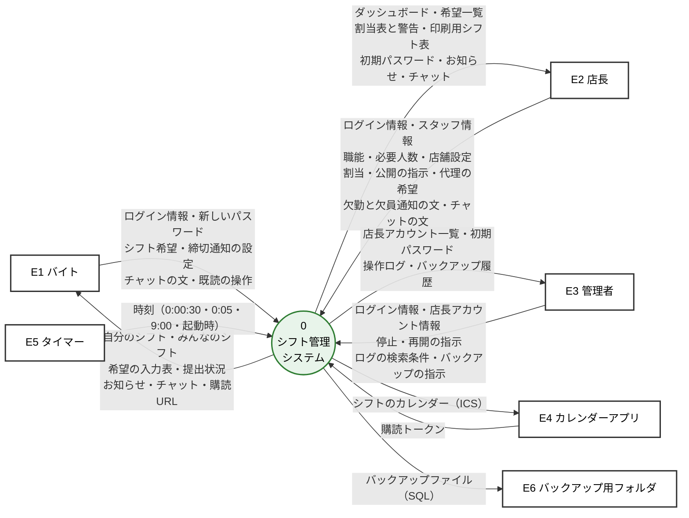

| データフロー | 向き | 中身（主な項目） |
| --- | --- | --- |
| ログイン情報 | E1・E2・E3 → 0 | ログインID、パスワード |
| 新しいパスワード | E1・E2・E3 → 0 | 今のパスワード、新しいパスワード、確認用（20-SC-03） |
| シフト希望 | E1 → 0 | 期間、日ごとに「枠ごとの○×」か「時間指定（開始・終了）」（20-SB-03） |
| 締切通知の設定 | E1 → 0 | 期限の 0・1・3・7 日前から選んだもの（20-SB-05） |
| 自分のシフト | 0 → E1 | 次の出勤、月・期間のカレンダー（確定した割当と、未確定の希望）（20-SB-01・02） |
| みんなのシフト | 0 → E1 | 公開済み期間の全員の割当表（店舗設定で見せないこともある）（20-SB-04） |
| お知らせ | 0 → E1・E2 | 件名、本文、日時、未読・既読（20-SC-02） |
| 購読URL | 0 → E1 | `https://…/ical/{トークン}.ics` と `webcal://…`（20-SB-05） |
| スタッフ情報 | E2 → 0 | ログインID、氏名、ふりがな、職能、研修中か、有効か（20-SM-03） |
| 職能・必要人数・店舗設定 | E2 → 0 | 職能名と説明、枠の必要職能、曜日・日付ごとの必要人数、店舗名とみんなのシフトを見せるか（20-SM-04・05・09） |
| 割当・公開の指示 | E2 → 0 | 期間、バイト、日付、枠か時間、公開（20-SM-06） |
| 代理の希望 | E2 → 0 | 期限後に店長が代わりに直す希望（20-SM-06-1） |
| 欠勤と欠員通知の文 | E2 → 0 | 欠勤する割当、理由、通知の文（20-SM-07） |
| ダッシュボード | 0 → E2 | 未提出者、人数不足、今後の欠員、募集期間の一覧（20-SM-01） |
| 割当表と警告 | 0 → E2 | 希望と割当の表、日ごと・枠ごとの人数、人数不足・職能不足・研修中のみの警告（20-SM-06） |
| 初期パスワード | 0 → E2・E3 | 登録・初期化のときに1回だけ出す（20-SM-03・20-SA-02） |
| 店長アカウント情報 | E3 → 0 | ログインID、氏名、ふりがな（20-SA-02） |
| ログの検索条件 | E3 → 0 | 期間、操作した人、操作の種類（20-SA-03） |
| 購読トークン | E4 → 0 | URL に入った43文字のトークン（20-IC-01） |
| シフトのカレンダー（ICS） | 0 → E4 | 公開済みで出勤の割当（31日前以降）を iCalendar 形式にしたもの（20-IC-01） |
| 時刻 | E5 → 0 | BT-02 毎日 0:00:30、BT-01 毎日 0:05、BT-03 毎日 9:00、BT-01・02 は起動時にも（95） |
| バックアップファイル | 0 → E6 | `backup_yyyyMMdd_HHmmss.sql`（`mysqldump` の結果）（20-SA-04） |

---

## 4. レベル0（全体図）

コンテキスト図の「0」を11のプロセスに分けたものです。D3 シフト枠と、全要求で共通の読み取りは 1.3 のとおり省いています。

レベル0は線が70本ほどあり、1枚に描くと線が重なって読めません。そこで、同じ図を次の2つの見方に分けて描きます（プロセス・外部実体・データストアは同じものです）。1枚にまとめた図は、印刷用の PNG（6章の `DFD_1_レベル0_全体.png`）にあります。

- **4.1 外部実体とプロセス**：だれが、どのプロセスに、何を渡し、何を受け取るか。プロセスどうしのやり取りもここに書きます。
- **4.2 プロセスとデータストア**：どのプロセスが、どのテーブルを読み書きするか。

### 4.1 外部実体とプロセス

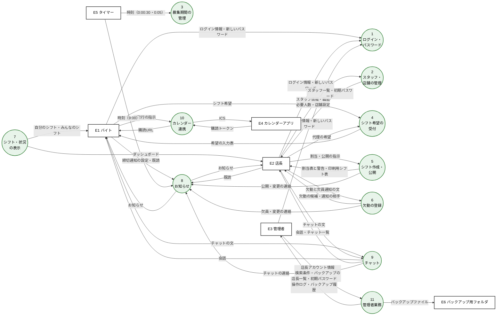

プロセスどうしの線（5・6・9 → 8）は、`NotificationService` のメソッドを同じトランザクションの中で呼ぶことを表します（30-05 1.2「必須」）。お知らせを作るのは 8 だけです（30-05 0章）。

### 4.2 プロセスとデータストア

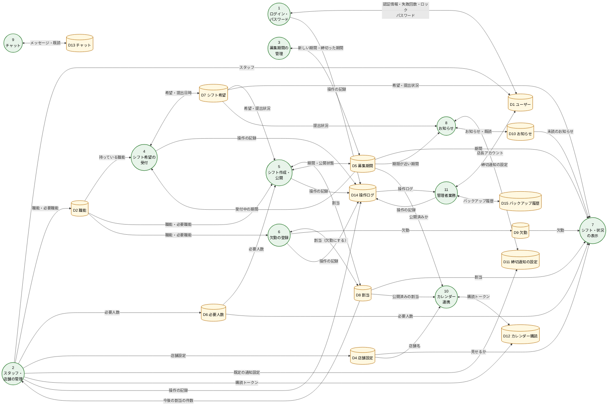

D1 ユーザーは、ほかのプロセスも宛先・氏名・有効かを読みます（2.2 の表）。この図では、書き込むプロセス（1・2・11）の線だけを描いています。

### 4.3 プロセスと画面・クラスの対応

| プロセス | 機能ID（10 3.1） | 画面・定期処理 | 主なクラス |
| --- | --- | --- | --- |
| 1 ログイン・パスワード | C-01、C-04 | SC-01、SC-03 | `LoginUserDetailsService`、`LoginAttemptService`、`LoginSuccessHandler`・`LoginFailureHandler`、`UserService` |
| 2 スタッフ・店舗の管理 | M-02、M-03、M-04、M-09 | SM-02、SM-03、SM-04、SM-05、SM-09 | `StaffService`、`SkillService`、`RequiredStaffService`、`StoreSettingService` |
| 3 募集期間の管理 | （定期処理） | BT-01、BT-02 | `PeriodScheduler`、`PeriodService` |
| 4 シフト希望の受付 | P-03、M-05 の一部 | SB-03、SM-06-1 | `ShiftRequestService` |
| 5 シフト作成・公開 | M-05、M-06、M-08 | SM-06、SM-08 | `AssignmentService`、`ShiftWarningService`、`ShiftTableService` |
| 6 欠勤の登録 | M-07 | SM-07 | `AbsenceService` |
| 7 シフト・状況の表示 | P-01、P-02、P-04、M-01 | SB-01、SB-02、SB-04、SM-01 | `StaffHomeService`、`ShiftCalendarService`、`ShiftTableService`、`DashboardService` |
| 8 お知らせ | C-03、P-06、（定期処理） | SC-02、SB-05（通知）、BT-03、ヘッダー | `NotificationService`、`NotificationSettingService`、`DeadlineNotificationScheduler` |
| 9 チャット | P-07、M-10 | SB-06、SM-10、SM-11 | `ChatService` |
| 10 カレンダー連携 | P-05 | SB-05（購読URL）、IC-01 | `CalendarFeedService` |
| 11 管理者業務 | A-01、A-02、A-03 | SA-01、SA-02、SA-03、SA-04 | `ManagerAccountService`、`OperationLogService`、`BackupService`・`BackupRecorder` |

---

## 5. レベル1（各プロセスの詳細）

各図の下の表の「手順」は、詳しい処理が書いてある詳細設計書の章です。

### 5.1 プロセス1 ログイン・パスワード

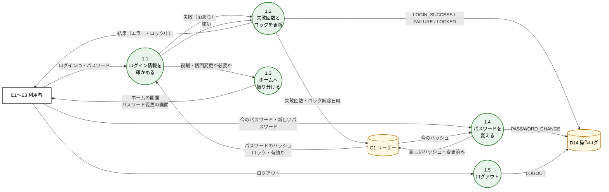

| プロセス | 内容 | 手順 |
| --- | --- | --- |
| 1.1 | `users` をログインIDで探し、ロック中・無効・パスワード違いを確かめる（Spring Security） | 20-SC-01 2.2-1〜2 |
| 1.2 | 成功なら失敗回数を0に、失敗なら＋1。5回目で `locked_until = 今＋15分`。操作ログは新しいトランザクションで入れる | 20-SC-01 2.2-3〜4 |
| 1.3 | `must_change_password` が TRUE なら SC-03 へ、それ以外は役割ごとのホーム（`HomeUrl`）へ | 20-SC-01 2.2-3 |
| 1.4 | 今のパスワードを確かめ、新しいハッシュを入れ、`must_change_password = FALSE` | 20-SC-03 2.2 |
| 1.5 | 操作ログを入れてセッションを破棄 | 20-SC-01 2.3 |

### 5.2 プロセス2 スタッフ・店舗の管理

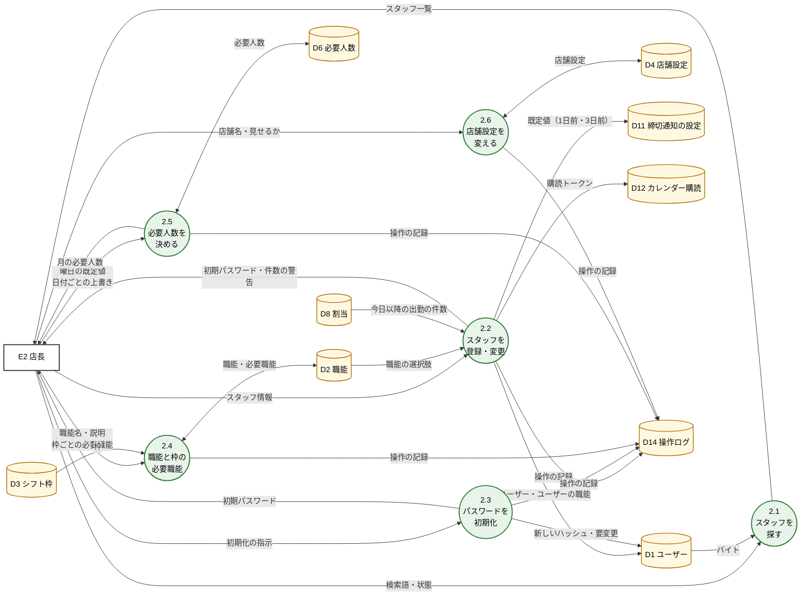

| プロセス | 内容 | 操作ログ | 手順 |
| --- | --- | --- | --- |
| 2.1 | 氏名・ふりがな・ログインIDの部分一致と、有効・無効で絞る | － | 20-SM-02 2.1 |
| 2.2 | 登録：`users`・`user_skills` に入れ、締切通知の設定（1・3）と購読トークンも作る。変更：有効→無効にしたときは今日以降の出勤の件数を返して警告に使う | STAFF_CREATE、STAFF_UPDATE | 20-SM-03 2.2・2.4 |
| 2.3 | ランダムな初期パスワードを作り、ハッシュを入れ、次のログインで変更させる | STAFF_PASSWORD_RESET | 20-SM-03 2.5 |
| 2.4 | 職能の追加・変更・削除と、日勤・夕勤それぞれの必要職能の保存 | SKILL_CREATE、SKILL_UPDATE、SKILL_DELETE、SLOT_SKILL_UPDATE | 20-SM-04 2.2〜2.5 |
| 2.5 | 曜日×枠の既定値と、日付×枠の上書き（追加・削除） | REQUIRED_UPDATE | 20-SM-05 2.2〜2.4 |
| 2.6 | 店舗名と、みんなのシフト（SB-04）をバイトに見せるか | STORE_SETTING_UPDATE | 20-SM-09 2.2 |

### 5.3 プロセス3 募集期間の管理

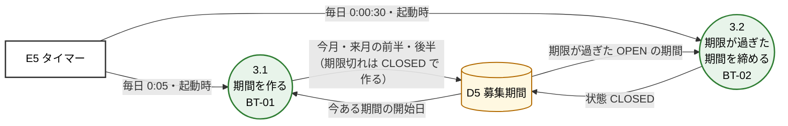

| プロセス | 内容 | 手順 |
| --- | --- | --- |
| 3.1 | 「今月」と「来月」の前半・後半の4期間のうち、ないものを作る。期限は 10 6.1 の決め方 | 95 2章 |
| 3.2 | `status = OPEN` で `deadline_at < 今` の期間を CLOSED（作成中）にする | 95 3章 |

PUBLISHED にするのは 5.4 の公開だけです。

### 5.4 プロセス4 シフト希望の受付

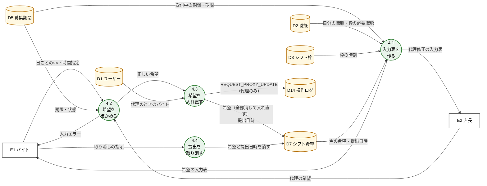

| プロセス | 内容 | 手順 |
| --- | --- | --- |
| 4.1 | 期間を選び、職能のある枠だけを選べる入力表を作る。バイトは受付中の期間、店長（代理）は OPEN か CLOSED の期間（PUBLISHED は E2612） | 20-SB-03 3.1、20-SM-06-1 3.1 |
| 4.2 | バイトは期限内か（`now <= deadline_at`。代理は期限を見ない）、職能のある枠すべてに○×があるか、時間指定が 8:00〜22:00・30分単位・職能のない枠と重ならないか | 20-SB-03 3.2-2、10 6.2 |
| 4.3 | その期間の本人の `shift_requests` を全部消して入れ直し、`request_submissions` に提出日時を入れる | 20-SB-03 3.2-3、20-SM-06-1 3.2 |
| 4.4 | 期限内だけ。その期間の本人の希望と提出日時を消す（未提出＝全部×に戻る） | 20-SB-03 3.3 |

### 5.5 プロセス5 シフト作成・公開

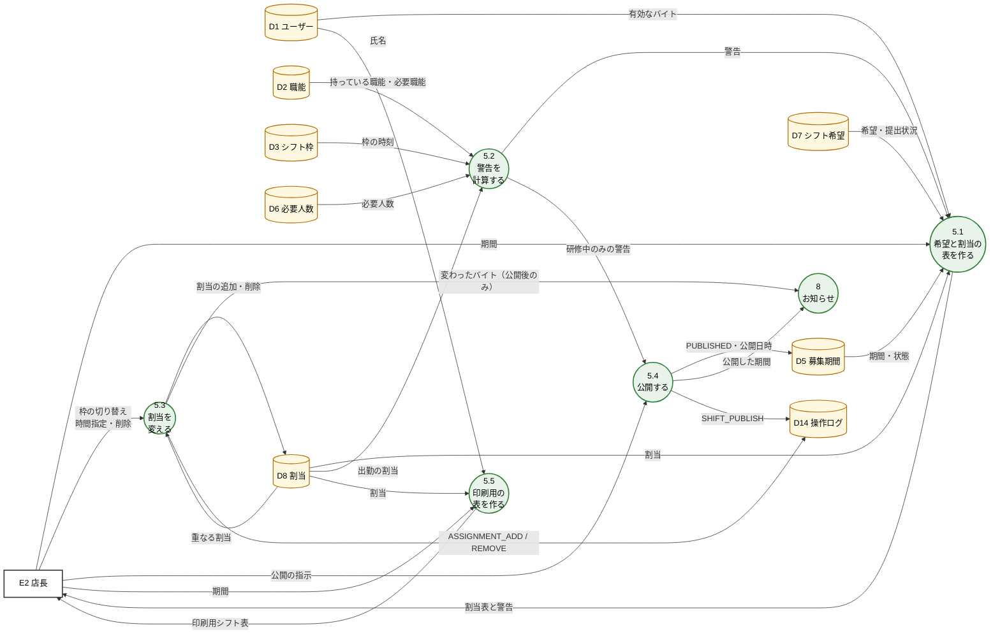

| プロセス | 内容 | 手順 |
| --- | --- | --- |
| 5.1 | 期間の全バイトの希望（未提出は×）と割当を1つの表にし、日ごと・枠ごとの人数を数える | 20-SM-06 3.2 |
| 5.2 | 人数不足（SHORTAGE）・職能不足（SKILL）・研修中のみ（TRAINEE_ONLY）。DB を読んだあとの計算は DB を使わない | 20-SM-06 4章、10 6.3 |
| 5.3 | 期間が CLOSED か PUBLISHED のときだけ。同じ人・同じ日に時間が重なる出勤は作らない（E2605）。公開後に変えたら本人へ CHANGED | 20-SM-06 3.3〜3.5 |
| 5.4 | 研修中のみの警告が1つでもあれば公開できない。公開したら有効なバイト全員へ PUBLISHED | 20-SM-06 3.6 |
| 5.5 | 出勤（ASSIGNED）だけを、枠ごとに数えて表にする | 20-SM-08 3.1 |

### 5.6 プロセス6 欠勤の登録

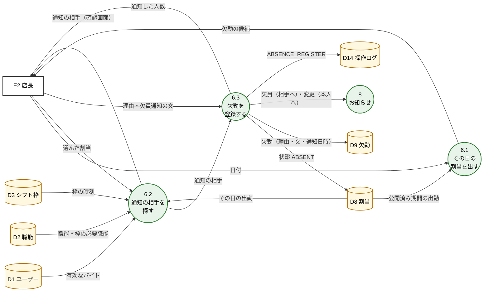

| プロセス | 内容 | 手順 |
| --- | --- | --- |
| 6.1 | 選んだ日の、公開済み期間の出勤の割当を出す | 20-SM-07 3.1 |
| 6.2 | 有効なバイトのうち、本人以外で、その枠の必要職能をすべて持ち、その日に時間が重なる出勤がない人（研修中も含む） | 20-SM-07 3.4、10 6.4 |
| 6.3 | 公開済み・まだ出勤・今日以降を確かめ、ABSENT にして `absences` に1行。相手へ VACANCY、本人へ CHANGED | 20-SM-07 3.3 |

### 5.7 プロセス7 シフト・状況の表示

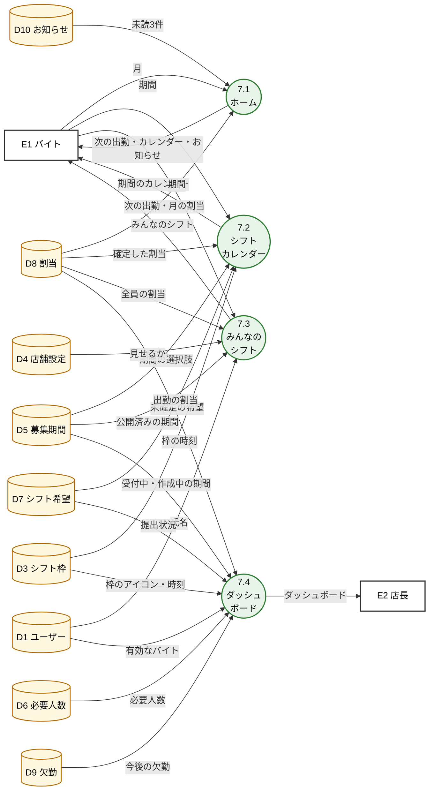

| プロセス | 内容 | 手順 |
| --- | --- | --- |
| 7.1 | 次の出勤、月のカレンダー（確定のバッジ）、未読のお知らせ3件 | 20-SB-01 2.1〜2.3 |
| 7.2 | 期間を選び、確定した割当と未確定の希望をバッジにして並べる | 20-SB-02 2.1 |
| 7.3 | 店舗設定で見せる設定のときだけ。公開済みの期間（3か月前の1日以降）の全員の割当 | 20-SB-04 2.1 |
| 7.4 | 未提出者、人数不足（5.2 の計算を使う）、今後の欠員、募集期間の一覧 | 20-SM-01 2.1 |

7.4 は `DashboardService` で作ります（PR #87 で令和8年11月24日にマージ済み）。

### 5.8 プロセス8 お知らせ

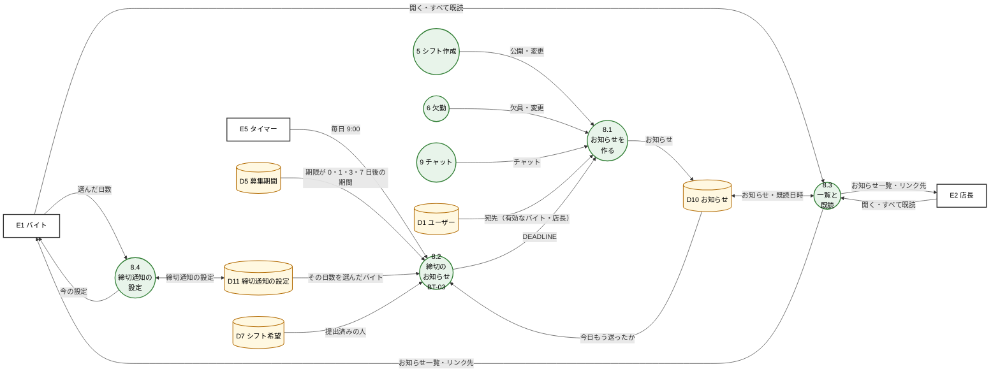

| プロセス | 内容 | 手順 |
| --- | --- | --- |
| 8.1 | `NotificationService` の `notifyPublished`・`notifyChanged`・`notifyVacancy`・`notifyChat` と `create`。件名は100文字、本文は500文字で切る | 30-05 1.2、95 5章、10 6.5 |
| 8.2 | 未提出で、その日数を選んだ有効なバイトへ DEADLINE。同じ日に同じ期間を2回送らない | 95 4章 |
| 8.3 | 最新100件の一覧。開いたら既読にしてリンク先へ。すべて既読 | 20-SC-02 2.1〜2.3 |
| 8.4 | 0・1・3・7 から選んで保存（全部消して入れ直す） | 20-SB-05 2.2 |

### 5.9 プロセス9 チャット

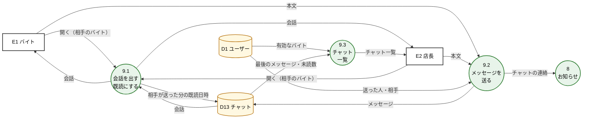

| プロセス | 内容 | 手順 |
| --- | --- | --- |
| 9.1 | 会話の単位はバイト1人（`staff_user_id`）。開いた人と違う側が送ったものを既読にする | 20-SB-06 2.1、20-SM-11 2.1 |
| 9.2 | バイトが送ったら有効な店長全員へ、店長が送ったらそのバイトへ CHAT のお知らせ | 20-SB-06 2.2、20-SM-11 2.2 |
| 9.3 | バイトごとの最後のメッセージと未読の数 | 20-SM-10 3.1 |

### 5.10 プロセス10 カレンダー連携

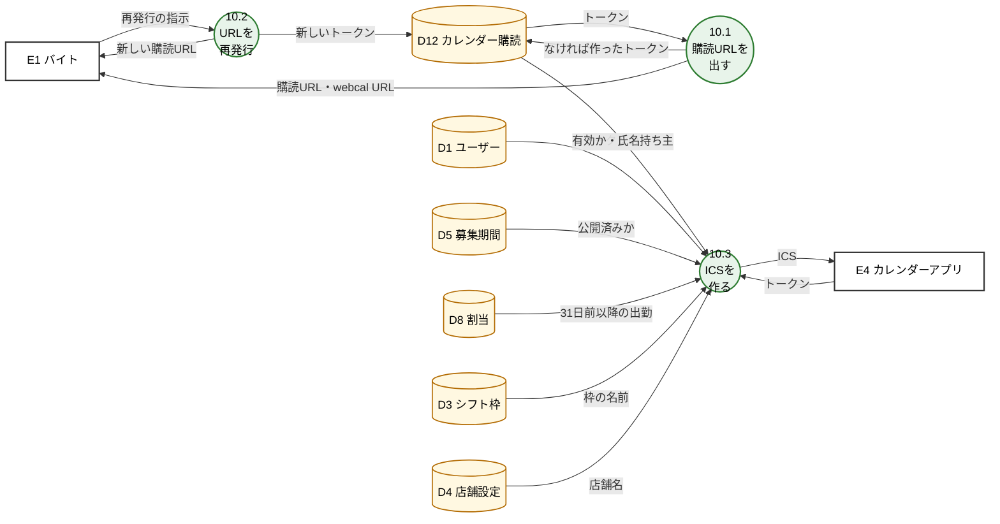

| プロセス | 内容 | 手順 |
| --- | --- | --- |
| 10.1 | SB-05 を開いたとき、トークンがなければ作る（GET でも書き込む） | 20-SB-05 2.1、30-05 1.4 |
| 10.2 | 新しいトークンに変える。古い URL は使えなくなる | 20-SB-05 2.3 |
| 10.3 | ログインなしでトークンだけで判定。無効な人・ないトークンは 404。欠勤になった割当は出さない | 20-IC-01 2〜3 |

### 5.11 プロセス11 管理者業務

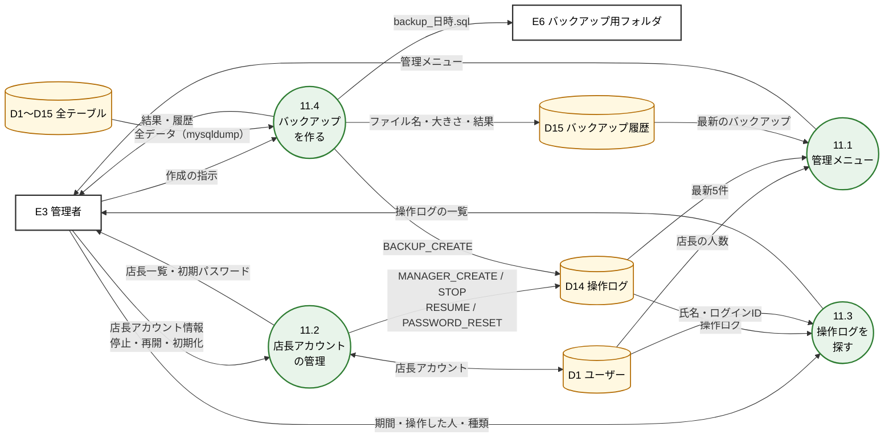

| プロセス | 内容 | 手順 |
| --- | --- | --- |
| 11.1 | 店長の人数、最新の操作ログ5件、最新のバックアップ | 20-SA-01 2.1 |
| 11.2 | 作成（初期パスワードを1回だけ出す）・停止・再開・パスワード初期化 | 20-SA-02 2.2〜2.5 |
| 11.3 | 期間・操作した人・種類で絞って、新しい順にページ分け | 20-SA-03 2.1 |
| 11.4 | `mysqldump` でデータベース全体を SQL ファイルにする（2つ同時には動かさない）。結果を `backups` と操作ログに新しいトランザクションで入れる | 20-SA-04 2.2 |

---

## 6. 画像（PNG）

印刷・提出用に、5章までと同じ内容を教科書どおりの記号（データストアは上下の二本線）で描いた画像です。中身は Mermaid の図と同じなので、直すときは Mermaid を直してから画像を作り直します。

| 図 | 画像 |
| --- | --- |
| コンテキスト図 | [DFD_0_コンテキスト図.png](images/DFD/DFD_0_コンテキスト図.png) |
| レベル0（1枚にまとめたもの） | [DFD_1_レベル0_全体.png](images/DFD/DFD_1_レベル0_全体.png)（大きいので A3 横か、画面で拡大して見る） |
| レベル0 4.1 外部実体とプロセス | [DFD_1a_レベル0_外部実体とプロセス.png](images/DFD/DFD_1a_レベル0_外部実体とプロセス.png) |
| レベル0 4.2 プロセスとデータストア | [DFD_1b_レベル0_プロセスとデータストア.png](images/DFD/DFD_1b_レベル0_プロセスとデータストア.png) |
| レベル1 プロセス1〜11 | `images/DFD/DFD_2-01_ログイン・パスワード.png` 〜 `DFD_2-11_管理者業務.png`（5章の順） |

---

## 7. 設計書と実装の照合で見つかった点

この図を作るときに、設計書（10・20・30-05・40・95）と令和8年11月24日時点の main のコードを照らし合わせました。データの流れについて、設計書と実装の食い違いはありませんでした。気づいた点を書いておきます。

| No. | 内容 | 扱い |
| --- | --- | --- |
| 1 | SM-01 ダッシュボード（7.4）は、第1.0版では PR #87 のマージ前だったので 20-SM-01 2.1 と 30-05 3.1 に合わせて描いた。マージ後の `DashboardService` と照らし合わせたところ、流れは合っていたが、欠員の表示に D3 シフト枠（枠のアイコン・重なる枠）を読む線が抜けていた | 第1.1版で線を足した（対応済み） |
| 2 | スタッフ登録（2.2）で購読トークン（D12）も作る流れは、30-05 3.2 の依存に `CalendarFeedService` があり、20-SM-03 2.2-7 にも書いてある。SB-05 を開いたとき（10.1）にも、なければ作る | 設計どおり。直すことはない |
