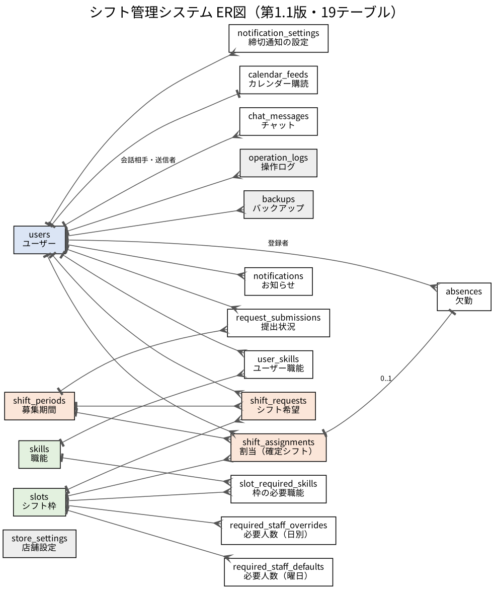

# 40 DB設計書

| 項目 | 内容 |
| --- | --- |
| 文書番号 | 40 |
| 版 | 第1.1版（令和8年10月22日） |
| 対象読者 | 実装をする班員 |
| もとにした資料 | 05_DB設計 第1.1版、schema_v1.1.sql、ER図_v1.1.png |

## 改版履歴

| 版 | 日付 | 内容 | 作成者 |
| --- | --- | --- | --- |
| 1.0 | 令和8年10月21日 | 初版作成 | 新井 |
| 1.1 | 令和8年10月22日 | 設計書評価の指摘を反映：初期管理者の平文パスワードを削除（H3）。行を消す一覧に request_submissions を追加（L9）。ログインIDの説明を書く画面を明記（L10） | 新井 |

## 1. 概要

| 項目 | 内容 |
| --- | --- |
| DBMS | MySQL 8.4.5（新井のPC、サービス名 MySQL84） |
| データベース | 本番用 `shift_management`、テスト用 `shift_test` |
| 文字コード・照合順序 | `utf8mb4`・`utf8mb4_0900_ai_ci`（MySQL 8.4 の既定。4章） |
| ストレージエンジン | InnoDB（既定） |
| 接続ユーザー | アプリ用 `shift_app`（`shift_management` だけに権限）。作り方は 96_環境構築手順書 3章 |
| 時刻 | 日本時間で保存する。JDBC の URL に `connectionTimeZone=%2B09:00&forceConnectionTimeZoneToSession=true` を付け、アプリの JVM も Asia/Tokyo にする（30-01 1章） |
| テーブルの作り方 | Flyway（`src/main/resources/db/migration`）。手で `CREATE TABLE` してはいけない（7章） |
| テーブル数 | 19（05_DB設計 第1.1版と同じ） |

### 1.1 05_DB設計からの変更

なし。`V1__create_tables.sql` は schema_v1.1.sql の CREATE TABLE 部分と同じ内容です（初期データは `V2__insert_initial_data.sql` に分けました）。

## 2. テーブルの一覧



| No. | テーブル | 日本語名 | エンティティ | 主な画面 |
| --- | --- | --- | --- | --- |
| 1 | users | ユーザー | `User` | SC-01、SM-02、SM-03、SA-02 |
| 2 | skills | 職能 | `Skill` | SM-04 |
| 3 | user_skills | ユーザーの職能 | （`User.skills`） | SM-03 |
| 4 | slots | シフト枠 | `Slot` | 全般（固定2行） |
| 5 | slot_required_skills | 枠の必要職能 | （`Slot.requiredSkills`） | SM-04 |
| 6 | store_settings | 店舗設定 | `StoreSetting` | SM-09、ヘッダー |
| 7 | shift_periods | 募集期間 | `ShiftPeriod` | SB-02、SB-03、SM-06、BT-01〜03 |
| 8 | required_staff_defaults | 必要人数（曜日の既定値） | `RequiredStaffDefault` | SM-05 |
| 9 | required_staff_overrides | 必要人数（日付ごとの上書き） | `RequiredStaffOverride` | SM-05 |
| 10 | request_submissions | 希望の提出状況 | `RequestSubmission` | SB-03、SM-01、SM-06 |
| 11 | shift_requests | シフト希望 | `ShiftRequest` | SB-03、SM-06、SM-06-1 |
| 12 | shift_assignments | 割当（確定シフト） | `ShiftAssignment` | SM-06、SB-01、SB-02、SB-04、IC-01 |
| 13 | absences | 欠勤 | `Absence` | SM-07、SM-01 |
| 14 | notifications | お知らせ | `Notification` | SC-02、ヘッダー |
| 15 | notification_settings | 締切通知の設定 | `NotificationSetting` | SB-05、BT-03 |
| 16 | calendar_feeds | カレンダー購読 | `CalendarFeed` | SB-05、IC-01 |
| 17 | chat_messages | チャット | `ChatMessage` | SB-06、SM-10、SM-11 |
| 18 | operation_logs | 操作ログ | `OperationLog` | SA-03 |
| 19 | backups | バックアップ履歴 | `Backup` | SA-04 |

## 3. テーブルの定義

「NOT NULL」の ○ は NULL を入れられない列です。既定値のある列は、アプリから値を入れず DB に任せます（30-02 0章）。

### 3.1 users（ユーザー）

エンティティ：`User`

| No. | 列名 | 型 | NOT NULL | 既定値 | キー | 説明 |
| --- | --- | --- | --- | --- | --- | --- |
| 1 | `id` | BIGINT | ○ |  | PK、自動採番 | 主キー |
| 2 | `login_id` | VARCHAR(20) | ○ |  | UQ | ログインID（半角英数字4〜20文字。大文字・小文字は区別しない：4章） |
| 3 | `password_hash` | VARCHAR(100) | ○ |  |  | BCryptのハッシュ（60文字） |
| 4 | `name` | VARCHAR(50) | ○ |  |  | 氏名 |
| 5 | `name_kana` | VARCHAR(50) |  |  |  | ふりがな（バイトは必須、店長・管理者は任意） |
| 6 | `role` | ENUM('ADMIN','MANAGER','STAFF') | ○ |  |  | ADMIN／MANAGER／STAFF |
| 7 | `is_trainee` | BOOLEAN | ○ | `FALSE` |  | 研修中か |
| 8 | `is_active` | BOOLEAN | ○ | `TRUE` |  | 有効か（FALSE＝無効・停止） |
| 9 | `must_change_password` | BOOLEAN | ○ | `TRUE` |  | 次のログインでパスワード変更が必要か |
| 10 | `failed_login_count` | INT | ○ | `0` |  | 連続で失敗した回数（5回でロックし0に戻す） |
| 11 | `locked_until` | DATETIME |  |  |  | ロックが解ける日時 |
| 12 | `created_at` | DATETIME | ○ | `CURRENT_TIMESTAMP` |  | 登録日時 |
| 13 | `updated_at` | DATETIME | ○ | `CURRENT_TIMESTAMP ON UPDATE CURRENT_TIMESTAMP` |  | 更新日時（行を更新するとDBが自動で入れる） |

### 3.2 skills（職能）

エンティティ：`Skill`

| No. | 列名 | 型 | NOT NULL | 既定値 | キー | 説明 |
| --- | --- | --- | --- | --- | --- | --- |
| 1 | `id` | BIGINT | ○ |  | PK、自動採番 | 主キー |
| 2 | `name` | VARCHAR(50) | ○ |  | UQ | 職能名 |
| 3 | `description` | VARCHAR(200) |  |  |  | 説明 |
| 4 | `created_at` | DATETIME | ○ | `CURRENT_TIMESTAMP` |  | 登録日時 |

### 3.3 user_skills（ユーザーの職能）

エンティティ：`（User.skills）`

| No. | 列名 | 型 | NOT NULL | 既定値 | キー | 説明 |
| --- | --- | --- | --- | --- | --- | --- |
| 1 | `user_id` | BIGINT | ○ |  |  | ユーザー |
| 2 | `skill_id` | BIGINT | ○ |  |  | 職能 |

制約・索引：

- `PRIMARY KEY (user_id, skill_id)`
- `FOREIGN KEY (user_id)  REFERENCES users(id)  ON DELETE CASCADE`
- `FOREIGN KEY (skill_id) REFERENCES skills(id) ON DELETE CASCADE`

### 3.4 slots（シフト枠）

エンティティ：`Slot`

| No. | 列名 | 型 | NOT NULL | 既定値 | キー | 説明 |
| --- | --- | --- | --- | --- | --- | --- |
| 1 | `id` | TINYINT | ○ |  | PK | 1＝日勤、2＝夕勤 |
| 2 | `code` | VARCHAR(10) | ○ |  | UQ | DAY／EVENING |
| 3 | `name` | VARCHAR(10) | ○ |  |  | 日勤／夕勤 |
| 4 | `start_time` | TIME | ○ |  |  | 開始 |
| 5 | `end_time` | TIME | ○ |  |  | 終了 |

### 3.5 slot_required_skills（枠の必要職能）

エンティティ：`（Slot.requiredSkills）`

| No. | 列名 | 型 | NOT NULL | 既定値 | キー | 説明 |
| --- | --- | --- | --- | --- | --- | --- |
| 1 | `slot_id` | TINYINT | ○ |  |  | 枠 |
| 2 | `skill_id` | BIGINT | ○ |  |  | その枠に必要な職能 |

制約・索引：

- `PRIMARY KEY (slot_id, skill_id)`
- `FOREIGN KEY (slot_id)  REFERENCES slots(id)`
- `FOREIGN KEY (skill_id) REFERENCES skills(id) ON DELETE CASCADE`

### 3.6 store_settings（店舗設定）

エンティティ：`StoreSetting`

| No. | 列名 | 型 | NOT NULL | 既定値 | キー | 説明 |
| --- | --- | --- | --- | --- | --- | --- |
| 1 | `id` | TINYINT | ○ | `1` | PK | 常に1 |
| 2 | `store_name` | VARCHAR(50) | ○ |  |  | 店舗名 |
| 3 | `show_others_shifts` | BOOLEAN | ○ | `TRUE` |  | バイトにみんなのシフト（SB-04）を見せるか |
| 4 | `updated_at` | DATETIME | ○ | `CURRENT_TIMESTAMP ON UPDATE CURRENT_TIMESTAMP` |  | 更新日時 |

制約・索引：

- `CHECK (id = 1)`

### 3.7 shift_periods（募集期間）

エンティティ：`ShiftPeriod`

| No. | 列名 | 型 | NOT NULL | 既定値 | キー | 説明 |
| --- | --- | --- | --- | --- | --- | --- |
| 1 | `id` | BIGINT | ○ |  | PK、自動採番 | 主キー |
| 2 | `start_date` | DATE | ○ |  | UQ | 開始日（1日か16日） |
| 3 | `end_date` | DATE | ○ |  |  | 終了日（15日か末日） |
| 4 | `deadline_at` | DATETIME | ○ |  |  | 提出期限（23:59:59） |
| 5 | `status` | ENUM('OPEN','CLOSED','PUBLISHED') | ○ | `'OPEN'` |  | OPEN／CLOSED／PUBLISHED |
| 6 | `published_at` | DATETIME |  |  |  | 公開した日時 |

制約・索引：

- `CHECK (start_date <= end_date)`

### 3.8 required_staff_defaults（必要人数（曜日の既定値））

エンティティ：`RequiredStaffDefault`

| No. | 列名 | 型 | NOT NULL | 既定値 | キー | 説明 |
| --- | --- | --- | --- | --- | --- | --- |
| 1 | `day_of_week` | TINYINT | ○ |  |  | 0＝日〜6＝土 |
| 2 | `slot_id` | TINYINT | ○ |  |  | 枠 |
| 3 | `required_count` | INT | ○ |  |  | 必要人数 |

制約・索引：

- `PRIMARY KEY (day_of_week, slot_id)`
- `FOREIGN KEY (slot_id) REFERENCES slots(id)`
- `CHECK (day_of_week BETWEEN 0 AND 6)`
- `CHECK (required_count >= 0)`

### 3.9 required_staff_overrides（必要人数（日付ごとの上書き））

エンティティ：`RequiredStaffOverride`

| No. | 列名 | 型 | NOT NULL | 既定値 | キー | 説明 |
| --- | --- | --- | --- | --- | --- | --- |
| 1 | `work_date` | DATE | ○ |  |  | 日付 |
| 2 | `slot_id` | TINYINT | ○ |  |  | 枠 |
| 3 | `required_count` | INT | ○ |  |  | 必要人数 |

制約・索引：

- `PRIMARY KEY (work_date, slot_id)`
- `FOREIGN KEY (slot_id) REFERENCES slots(id)`
- `CHECK (required_count >= 0)`

### 3.10 request_submissions（希望の提出状況）

エンティティ：`RequestSubmission`

| No. | 列名 | 型 | NOT NULL | 既定値 | キー | 説明 |
| --- | --- | --- | --- | --- | --- | --- |
| 1 | `period_id` | BIGINT | ○ |  |  | 期間 |
| 2 | `user_id` | BIGINT | ○ |  |  | バイト |
| 3 | `submitted_at` | DATETIME | ○ |  |  | 最後に提出（保存）した日時 |

制約・索引：

- `PRIMARY KEY (period_id, user_id)`
- `FOREIGN KEY (period_id) REFERENCES shift_periods(id) ON DELETE CASCADE`
- `FOREIGN KEY (user_id)   REFERENCES users(id) ON DELETE CASCADE`

### 3.11 shift_requests（シフト希望）

エンティティ：`ShiftRequest`

| No. | 列名 | 型 | NOT NULL | 既定値 | キー | 説明 |
| --- | --- | --- | --- | --- | --- | --- |
| 1 | `id` | BIGINT | ○ |  | PK、自動採番 | 主キー |
| 2 | `period_id` | BIGINT | ○ |  |  | 期間 |
| 3 | `user_id` | BIGINT | ○ |  |  | バイト |
| 4 | `work_date` | DATE | ○ |  |  | 日付 |
| 5 | `slot_id` | TINYINT |  |  |  | 枠（時間指定は NULL） |
| 6 | `availability` | ENUM('OK','NG','TIME') | ○ |  |  | OK／NG／TIME |
| 7 | `start_time` | TIME |  |  |  | 時間指定の開始 |
| 8 | `end_time` | TIME |  |  |  | 時間指定の終了 |
| 9 | `updated_at` | DATETIME | ○ | `CURRENT_TIMESTAMP ON UPDATE CURRENT_TIMESTAMP` |  | 更新日時 |

制約・索引：

- `UNIQUE KEY uq_request (user_id, work_date, slot_id)`
- `FOREIGN KEY (period_id) REFERENCES shift_periods(id) ON DELETE CASCADE`
- `FOREIGN KEY (user_id)   REFERENCES users(id) ON DELETE CASCADE`
- `FOREIGN KEY (slot_id)   REFERENCES slots(id)`
- `CHECK ((availability = 'TIME' AND slot_id IS NULL AND start_time IS NOT NULL AND end_time IS NOT NULL AND start_time < end_time) OR (availability <> 'TIME' AND slot_id IS NOT NULL AND start_time IS NULL AND end_time IS NULL))`

### 3.12 shift_assignments（割当（確定シフト））

エンティティ：`ShiftAssignment`

| No. | 列名 | 型 | NOT NULL | 既定値 | キー | 説明 |
| --- | --- | --- | --- | --- | --- | --- |
| 1 | `id` | BIGINT | ○ |  | PK、自動採番 | 主キー |
| 2 | `period_id` | BIGINT | ○ |  |  | 期間 |
| 3 | `user_id` | BIGINT | ○ |  |  | バイト |
| 4 | `work_date` | DATE | ○ |  |  | 日付 |
| 5 | `slot_id` | TINYINT |  |  |  | 枠（時間指定は NULL） |
| 6 | `start_time` | TIME | ○ |  |  | 開始（枠のときは枠の時刻をコピー） |
| 7 | `end_time` | TIME | ○ |  |  | 終了 |
| 8 | `status` | ENUM('ASSIGNED','ABSENT') | ○ | `'ASSIGNED'` |  | ASSIGNED（出勤）／ABSENT（欠勤） |
| 9 | `created_at` | DATETIME | ○ | `CURRENT_TIMESTAMP` |  | 登録日時 |
| 10 | `updated_at` | DATETIME | ○ | `CURRENT_TIMESTAMP ON UPDATE CURRENT_TIMESTAMP` |  | 更新日時 |

制約・索引：

- `INDEX idx_assign_date (work_date, slot_id)`
- `INDEX idx_assign_user (user_id, work_date)`
- `FOREIGN KEY (period_id) REFERENCES shift_periods(id) ON DELETE CASCADE`
- `FOREIGN KEY (user_id)   REFERENCES users(id)`
- `FOREIGN KEY (slot_id)   REFERENCES slots(id)`
- `CHECK (start_time < end_time)`

### 3.13 absences（欠勤）

エンティティ：`Absence`

| No. | 列名 | 型 | NOT NULL | 既定値 | キー | 説明 |
| --- | --- | --- | --- | --- | --- | --- |
| 1 | `id` | BIGINT | ○ |  | PK、自動採番 | 主キー |
| 2 | `assignment_id` | BIGINT | ○ |  | UQ | 欠勤になった割当（1つの割当に1行） |
| 3 | `registered_by` | BIGINT | ○ |  |  | 登録した店長 |
| 4 | `reason` | VARCHAR(200) |  |  |  | 理由 |
| 5 | `notice_message` | VARCHAR(500) | ○ |  |  | 欠員通知の文 |
| 6 | `notified_at` | DATETIME |  |  |  | 通知した日時 |
| 7 | `created_at` | DATETIME | ○ | `CURRENT_TIMESTAMP` |  | 登録日時 |

制約・索引：

- `FOREIGN KEY (assignment_id) REFERENCES shift_assignments(id) ON DELETE CASCADE`
- `FOREIGN KEY (registered_by) REFERENCES users(id)`

### 3.14 notifications（お知らせ）

エンティティ：`Notification`

| No. | 列名 | 型 | NOT NULL | 既定値 | キー | 説明 |
| --- | --- | --- | --- | --- | --- | --- |
| 1 | `id` | BIGINT | ○ |  | PK、自動採番 | 主キー |
| 2 | `user_id` | BIGINT | ○ |  |  | 宛先 |
| 3 | `type` | ENUM('DEADLINE','PUBLISHED','CHANGED','VACANCY','CHAT') | ○ |  |  | 種類 |
| 4 | `title` | VARCHAR(100) | ○ |  |  | 件名 |
| 5 | `body` | VARCHAR(500) |  |  |  | 本文 |
| 6 | `link_url` | VARCHAR(200) |  |  |  | 開いたときの移動先（アプリ内のパス） |
| 7 | `read_at` | DATETIME |  |  |  | 既読にした日時（NULL＝未読） |
| 8 | `created_at` | DATETIME | ○ | `CURRENT_TIMESTAMP` |  | 作成日時 |

制約・索引：

- `INDEX idx_notice_user (user_id, read_at)`
- `FOREIGN KEY (user_id) REFERENCES users(id) ON DELETE CASCADE`

### 3.15 notification_settings（締切通知の設定）

エンティティ：`NotificationSetting`

| No. | 列名 | 型 | NOT NULL | 既定値 | キー | 説明 |
| --- | --- | --- | --- | --- | --- | --- |
| 1 | `user_id` | BIGINT | ○ |  |  | バイト |
| 2 | `days_before` | TINYINT | ○ |  |  | 何日前に知らせるか（0・1・3・7） |

制約・索引：

- `PRIMARY KEY (user_id, days_before)`
- `FOREIGN KEY (user_id) REFERENCES users(id) ON DELETE CASCADE`
- `CHECK (days_before IN (0,1,3,7))`

### 3.16 calendar_feeds（カレンダー購読）

エンティティ：`CalendarFeed`

| No. | 列名 | 型 | NOT NULL | 既定値 | キー | 説明 |
| --- | --- | --- | --- | --- | --- | --- |
| 1 | `user_id` | BIGINT | ○ |  | PK | バイト（主キー） |
| 2 | `token` | CHAR(43) | ○ |  | UQ | 購読URLのトークン（43文字） |
| 3 | `created_at` | DATETIME | ○ | `CURRENT_TIMESTAMP` |  | 発行日時 |

制約・索引：

- `FOREIGN KEY (user_id) REFERENCES users(id) ON DELETE CASCADE`

### 3.17 chat_messages（チャット）

エンティティ：`ChatMessage`

| No. | 列名 | 型 | NOT NULL | 既定値 | キー | 説明 |
| --- | --- | --- | --- | --- | --- | --- |
| 1 | `id` | BIGINT | ○ |  | PK、自動採番 | 主キー |
| 2 | `staff_user_id` | BIGINT | ○ |  |  | 会話の相手のバイト（会話の単位） |
| 3 | `sender_user_id` | BIGINT | ○ |  |  | 送った人（バイトか店長） |
| 4 | `body` | VARCHAR(500) | ○ |  |  | 本文 |
| 5 | `read_at` | DATETIME |  |  |  | 相手が読んだ日時 |
| 6 | `created_at` | DATETIME | ○ | `CURRENT_TIMESTAMP` |  | 送信日時 |

制約・索引：

- `INDEX idx_chat (staff_user_id, created_at)`
- `FOREIGN KEY (staff_user_id)  REFERENCES users(id) ON DELETE CASCADE`
- `FOREIGN KEY (sender_user_id) REFERENCES users(id) ON DELETE CASCADE`

### 3.18 operation_logs（操作ログ）

エンティティ：`OperationLog`

| No. | 列名 | 型 | NOT NULL | 既定値 | キー | 説明 |
| --- | --- | --- | --- | --- | --- | --- |
| 1 | `id` | BIGINT | ○ |  | PK、自動採番 | 主キー |
| 2 | `user_id` | BIGINT |  |  |  | 操作した人（ログイン失敗でIDがないときは NULL） |
| 3 | `action` | VARCHAR(50) | ○ |  |  | 操作の種類（OperationAction の名前） |
| 4 | `target` | VARCHAR(100) |  |  |  | 対象（例：user:12） |
| 5 | `detail` | VARCHAR(500) |  |  |  | 内容 |
| 6 | `ip_address` | VARCHAR(45) |  |  |  | 接続元のIPアドレス |
| 7 | `created_at` | DATETIME | ○ | `CURRENT_TIMESTAMP` |  | 操作日時 |

制約・索引：

- `INDEX idx_log_time (created_at)`
- `FOREIGN KEY (user_id) REFERENCES users(id) ON DELETE SET NULL`

### 3.19 backups（バックアップ履歴）

エンティティ：`Backup`

| No. | 列名 | 型 | NOT NULL | 既定値 | キー | 説明 |
| --- | --- | --- | --- | --- | --- | --- |
| 1 | `id` | BIGINT | ○ |  | PK、自動採番 | 主キー |
| 2 | `file_name` | VARCHAR(200) | ○ |  |  | ファイル名 |
| 3 | `file_size` | BIGINT |  |  |  | 大きさ（バイト。失敗は NULL） |
| 4 | `status` | ENUM('SUCCESS','FAILED') | ○ |  |  | SUCCESS／FAILED |
| 5 | `created_by` | BIGINT |  |  |  | 作った管理者 |
| 6 | `created_at` | DATETIME | ○ | `CURRENT_TIMESTAMP` |  | 作成日時 |

制約・索引：

- `FOREIGN KEY (created_by) REFERENCES users(id) ON DELETE SET NULL`


## 4. 文字の比べ方と並び順

| 項目 | 動き | 理由・対応 |
| --- | --- | --- |
| ログインID | 大文字と小文字を**区別しない**（`Admin` と `admin` は同じID。照合順序が `_ci` のため） | 一意制約もログインも同じ比べ方になるので矛盾は起きない。画面の説明にも「大文字・小文字は区別しません」と書く（20-SC-01・20-SM-03・20-SA-02 の画面項目の備考） |
| 職能名 | 同じく区別しない（`POS` と `pos` は重複） | 同上 |
| ふりがなの並び | ひらがなの五十音順 | `ORDER BY name_kana ASC NULLS LAST, id ASC`（30-03） |
| 空白 | 前後の空白は `GlobalModelAdvice` が取る（30-06） | DBに入る前に取る |

## 5. 消したときの動き（外部キー）

アプリから行を消すのは、職能（SM-04）、希望（SB-03・SM-06-1 の再提出で入れ直すとき、SB-03 の取り消し）、提出の記録 `request_submissions`（SB-03 の取り消し）、割当（SM-06）、必要人数の上書き（SM-05）、締切通知の設定（SB-05）だけです。ユーザー・期間は消しません（無効にするだけ）。

| 親 | 子 | 親を消したとき |
| --- | --- | --- |
| skills | user_skills、slot_required_skills | 子も消える（CASCADE） |
| users | user_skills、request_submissions、shift_requests、notifications、notification_settings、calendar_feeds、chat_messages | 子も消える（CASCADE）※ユーザーは消さない運用 |
| users | operation_logs、backups | 子の user_id・created_by が NULL になる（SET NULL） |
| users | shift_assignments、absences.registered_by | 消せない（割当があるユーザーは消さない） |
| shift_periods | request_submissions、shift_requests、shift_assignments | 子も消える（CASCADE）※期間は消さない運用 |
| shift_assignments | absences | 子も消える（CASCADE）※欠勤の割当は SM-06 で消せない（E2603） |
| slots | 各テーブル | 消せない（枠は固定） |

## 6. 索引と、それを使うクエリ

| 索引 | 列 | 使うクエリ（30-03） |
| --- | --- | --- |
| users.login_id（UNIQUE） | login_id | `findByLoginId`、`existsByLoginId` |
| shift_periods.start_date（UNIQUE） | start_date | `existsByStartDate`（BT-01の重複防止）、期間の並び |
| uq_request（UNIQUE） | user_id, work_date, slot_id | 同じ人・同じ日・同じ枠の希望の重複防止。`findByUserIdAndWorkDateBetween` |
| idx_assign_date | work_date, slot_id | `findPublishedByWorkDate`、`findAssignedByWorkDate`、`findByWorkDateAndStatus` |
| idx_assign_user | user_id, work_date | `findNextShifts`、`findByUserIdAndWorkDateBetween`、`findPublishedForFeed` |
| idx_notice_user | user_id, read_at | `countByUserIdAndReadAtIsNull`（全画面のヘッダー）、`markAllRead` |
| idx_chat | staff_user_id, created_at | `findLatest200` |
| idx_log_time | created_at | `OperationLogRepository#search` |
| calendar_feeds.token（UNIQUE） | token | `findByToken`（IC-01） |
| absences.assignment_id（UNIQUE） | assignment_id | 1つの割当に欠勤は1行だけ |

**注意：** `uq_request` は `slot_id` が NULL（時間指定）の行どうしでは重複を防げません（MySQL では NULL どうしは等しくないため）。時間指定は1日1行だけにするチェックは `ShiftRequestService` で行います（SB-03 は1日に mode を1つしか送れない形のため、保存する行も1日1行になる）。

## 7. Flyway の決まり

| 決まり | 内容 |
| --- | --- |
| ファイルの場所 | `src/main/resources/db/migration/` |
| 名前 | `V{番号}__{内容}.sql`（アンダースコア2つ）。番号は 1 から順に |
| 一度動かしたファイル | **絶対に書き換えない**（Flyway がチェックサムの違いで起動を止める）。直したいときは新しい番号のファイルを足す |
| 新しいファイルを足すとき | 先に 40_DB設計書を改版し、テーブルの定義（3章）を直してから足す |
| 開発中にやり直したいとき | 自分のPCの DB を `DROP DATABASE shift_management; CREATE DATABASE …`（96_環境構築手順書 3章）で作り直す |
| `ddl-auto` | `validate`（Hibernate はテーブルを変えない） |

### 7.1 V1__create_tables.sql（全文）

```sql
-- シフト管理システム テーブル作成（40_DB設計書 第1.0版）
CREATE TABLE users (
  id                    BIGINT AUTO_INCREMENT PRIMARY KEY,
  login_id              VARCHAR(20)  NOT NULL UNIQUE,
  password_hash         VARCHAR(100) NOT NULL,
  name                  VARCHAR(50)  NOT NULL,
  name_kana             VARCHAR(50),
  role                  ENUM('ADMIN','MANAGER','STAFF') NOT NULL,
  is_trainee            BOOLEAN NOT NULL DEFAULT FALSE,
  is_active             BOOLEAN NOT NULL DEFAULT TRUE,
  must_change_password  BOOLEAN NOT NULL DEFAULT TRUE,
  failed_login_count    INT NOT NULL DEFAULT 0,
  locked_until          DATETIME,
  created_at            DATETIME NOT NULL DEFAULT CURRENT_TIMESTAMP,
  updated_at            DATETIME NOT NULL DEFAULT CURRENT_TIMESTAMP ON UPDATE CURRENT_TIMESTAMP
);

CREATE TABLE skills (
  id          BIGINT AUTO_INCREMENT PRIMARY KEY,
  name        VARCHAR(50) NOT NULL UNIQUE,
  description VARCHAR(200),
  created_at  DATETIME NOT NULL DEFAULT CURRENT_TIMESTAMP
);

CREATE TABLE user_skills (
  user_id  BIGINT NOT NULL,
  skill_id BIGINT NOT NULL,
  PRIMARY KEY (user_id, skill_id),
  FOREIGN KEY (user_id)  REFERENCES users(id)  ON DELETE CASCADE,
  FOREIGN KEY (skill_id) REFERENCES skills(id) ON DELETE CASCADE
);

-- 固定シフト枠（日勤・夕勤）
CREATE TABLE slots (
  id         TINYINT PRIMARY KEY,
  code       VARCHAR(10) NOT NULL UNIQUE,
  name       VARCHAR(10) NOT NULL,
  start_time TIME NOT NULL,
  end_time   TIME NOT NULL
);

CREATE TABLE slot_required_skills (
  slot_id  TINYINT NOT NULL,
  skill_id BIGINT  NOT NULL,
  PRIMARY KEY (slot_id, skill_id),
  FOREIGN KEY (slot_id)  REFERENCES slots(id),
  FOREIGN KEY (skill_id) REFERENCES skills(id) ON DELETE CASCADE
);

-- 店舗設定（1行だけ）
CREATE TABLE store_settings (
  id                  TINYINT PRIMARY KEY DEFAULT 1,
  store_name          VARCHAR(50) NOT NULL,
  show_others_shifts  BOOLEAN NOT NULL DEFAULT TRUE,
  updated_at          DATETIME NOT NULL DEFAULT CURRENT_TIMESTAMP ON UPDATE CURRENT_TIMESTAMP,
  CHECK (id = 1)
);

-- 募集期間（前半：1〜15日、後半：16日〜末日）
CREATE TABLE shift_periods (
  id           BIGINT AUTO_INCREMENT PRIMARY KEY,
  start_date   DATE NOT NULL UNIQUE,
  end_date     DATE NOT NULL,
  deadline_at  DATETIME NOT NULL,
  status       ENUM('OPEN','CLOSED','PUBLISHED') NOT NULL DEFAULT 'OPEN',
  published_at DATETIME,
  CHECK (start_date <= end_date)
);

-- 必要人数：曜日ごとの既定値（day_of_week 0=日〜6=土）
CREATE TABLE required_staff_defaults (
  day_of_week    TINYINT NOT NULL,
  slot_id        TINYINT NOT NULL,
  required_count INT NOT NULL,
  PRIMARY KEY (day_of_week, slot_id),
  FOREIGN KEY (slot_id) REFERENCES slots(id),
  CHECK (day_of_week BETWEEN 0 AND 6),
  CHECK (required_count >= 0)
);

-- 必要人数：日付ごとの上書き
CREATE TABLE required_staff_overrides (
  work_date      DATE NOT NULL,
  slot_id        TINYINT NOT NULL,
  required_count INT NOT NULL,
  PRIMARY KEY (work_date, slot_id),
  FOREIGN KEY (slot_id) REFERENCES slots(id),
  CHECK (required_count >= 0)
);

-- 期間ごとの提出状況
CREATE TABLE request_submissions (
  period_id    BIGINT NOT NULL,
  user_id      BIGINT NOT NULL,
  submitted_at DATETIME NOT NULL,
  PRIMARY KEY (period_id, user_id),
  FOREIGN KEY (period_id) REFERENCES shift_periods(id) ON DELETE CASCADE,
  FOREIGN KEY (user_id)   REFERENCES users(id) ON DELETE CASCADE
);

-- シフト希望：枠ごとの○×は slot_id あり、時間指定は slot_id なし＋時刻
CREATE TABLE shift_requests (
  id            BIGINT AUTO_INCREMENT PRIMARY KEY,
  period_id     BIGINT NOT NULL,
  user_id       BIGINT NOT NULL,
  work_date     DATE NOT NULL,
  slot_id       TINYINT,
  availability  ENUM('OK','NG','TIME') NOT NULL,
  start_time    TIME,
  end_time      TIME,
  updated_at    DATETIME NOT NULL DEFAULT CURRENT_TIMESTAMP ON UPDATE CURRENT_TIMESTAMP,
  UNIQUE KEY uq_request (user_id, work_date, slot_id),
  FOREIGN KEY (period_id) REFERENCES shift_periods(id) ON DELETE CASCADE,
  FOREIGN KEY (user_id)   REFERENCES users(id) ON DELETE CASCADE,
  FOREIGN KEY (slot_id)   REFERENCES slots(id),
  CHECK ((availability = 'TIME' AND slot_id IS NULL AND start_time IS NOT NULL AND end_time IS NOT NULL AND start_time < end_time)
      OR (availability <> 'TIME' AND slot_id IS NOT NULL AND start_time IS NULL AND end_time IS NULL))
);

-- 割当（確定シフト）：時刻は枠からコピーして必ず持つ
CREATE TABLE shift_assignments (
  id          BIGINT AUTO_INCREMENT PRIMARY KEY,
  period_id   BIGINT NOT NULL,
  user_id     BIGINT NOT NULL,
  work_date   DATE NOT NULL,
  slot_id     TINYINT,
  start_time  TIME NOT NULL,
  end_time    TIME NOT NULL,
  status      ENUM('ASSIGNED','ABSENT') NOT NULL DEFAULT 'ASSIGNED',
  created_at  DATETIME NOT NULL DEFAULT CURRENT_TIMESTAMP,
  updated_at  DATETIME NOT NULL DEFAULT CURRENT_TIMESTAMP ON UPDATE CURRENT_TIMESTAMP,
  INDEX idx_assign_date (work_date, slot_id),
  INDEX idx_assign_user (user_id, work_date),
  FOREIGN KEY (period_id) REFERENCES shift_periods(id) ON DELETE CASCADE,
  FOREIGN KEY (user_id)   REFERENCES users(id),
  FOREIGN KEY (slot_id)   REFERENCES slots(id),
  CHECK (start_time < end_time)
);

CREATE TABLE absences (
  id             BIGINT AUTO_INCREMENT PRIMARY KEY,
  assignment_id  BIGINT NOT NULL UNIQUE,
  registered_by  BIGINT NOT NULL,
  reason         VARCHAR(200),
  notice_message VARCHAR(500) NOT NULL,
  notified_at    DATETIME,
  created_at     DATETIME NOT NULL DEFAULT CURRENT_TIMESTAMP,
  FOREIGN KEY (assignment_id) REFERENCES shift_assignments(id) ON DELETE CASCADE,
  FOREIGN KEY (registered_by) REFERENCES users(id)
);

CREATE TABLE notifications (
  id         BIGINT AUTO_INCREMENT PRIMARY KEY,
  user_id    BIGINT NOT NULL,
  type       ENUM('DEADLINE','PUBLISHED','CHANGED','VACANCY','CHAT') NOT NULL,
  title      VARCHAR(100) NOT NULL,
  body       VARCHAR(500),
  link_url   VARCHAR(200),
  read_at    DATETIME,
  created_at DATETIME NOT NULL DEFAULT CURRENT_TIMESTAMP,
  INDEX idx_notice_user (user_id, read_at),
  FOREIGN KEY (user_id) REFERENCES users(id) ON DELETE CASCADE
);

-- 締切通知のタイミング（0=当日,1=前日,3=3日前,7=7日前）。既定は1と3
CREATE TABLE notification_settings (
  user_id     BIGINT NOT NULL,
  days_before TINYINT NOT NULL,
  PRIMARY KEY (user_id, days_before),
  FOREIGN KEY (user_id) REFERENCES users(id) ON DELETE CASCADE,
  CHECK (days_before IN (0,1,3,7))
);

-- 外部カレンダー購読用URLのトークン
CREATE TABLE calendar_feeds (
  user_id    BIGINT PRIMARY KEY,
  token      CHAR(43) NOT NULL UNIQUE,
  created_at DATETIME NOT NULL DEFAULT CURRENT_TIMESTAMP,
  FOREIGN KEY (user_id) REFERENCES users(id) ON DELETE CASCADE
);

-- チャット：店長とバイトの1対1。staff_user_id で会話を分ける
CREATE TABLE chat_messages (
  id             BIGINT AUTO_INCREMENT PRIMARY KEY,
  staff_user_id  BIGINT NOT NULL,
  sender_user_id BIGINT NOT NULL,
  body           VARCHAR(500) NOT NULL,
  read_at        DATETIME,
  created_at     DATETIME NOT NULL DEFAULT CURRENT_TIMESTAMP,
  INDEX idx_chat (staff_user_id, created_at),
  FOREIGN KEY (staff_user_id)  REFERENCES users(id) ON DELETE CASCADE,
  FOREIGN KEY (sender_user_id) REFERENCES users(id) ON DELETE CASCADE
);

CREATE TABLE operation_logs (
  id         BIGINT AUTO_INCREMENT PRIMARY KEY,
  user_id    BIGINT,
  action     VARCHAR(50) NOT NULL,
  target     VARCHAR(100),
  detail     VARCHAR(500),
  ip_address VARCHAR(45),
  created_at DATETIME NOT NULL DEFAULT CURRENT_TIMESTAMP,
  INDEX idx_log_time (created_at),
  FOREIGN KEY (user_id) REFERENCES users(id) ON DELETE SET NULL
);

CREATE TABLE backups (
  id         BIGINT AUTO_INCREMENT PRIMARY KEY,
  file_name  VARCHAR(200) NOT NULL,
  file_size  BIGINT,
  status     ENUM('SUCCESS','FAILED') NOT NULL,
  created_by BIGINT,
  created_at DATETIME NOT NULL DEFAULT CURRENT_TIMESTAMP,
  FOREIGN KEY (created_by) REFERENCES users(id) ON DELETE SET NULL
);
```

### 7.2 V2__insert_initial_data.sql（全文）

```sql
-- シフト管理システム 初期データ（40_DB設計書 第1.0版）
INSERT INTO slots (id, code, name, start_time, end_time) VALUES
  (1, 'DAY',     '日勤', '08:00:00', '17:00:00'),
  (2, 'EVENING', '夕勤', '17:00:00', '22:00:00');

INSERT INTO store_settings (id, store_name, show_others_shifts) VALUES
  (1, 'セブンイレブン 三島駅西通り店', TRUE);

-- 初期管理者（初期パスワードは班の中だけで共有する。初回ログイン時に変更を強制する）
INSERT INTO users (login_id, password_hash, name, name_kana, role, must_change_password) VALUES
  ('admin', '$2a$10$nwP/4KBszvToflYP2jG7Xuot0dCbS9iyyW1nUypDuITDqBHfVvub6', '新井', 'あらい', 'ADMIN', TRUE);

-- 必要人数の曜日既定値（0=日〜6=土）。店長がSM-05で設定するまでは0人
INSERT INTO required_staff_defaults (day_of_week, slot_id, required_count) VALUES
  (0,1,0),(0,2,0),(1,1,0),(1,2,0),(2,1,0),(2,2,0),(3,1,0),(3,2,0),(4,1,0),(4,2,0),(5,1,0),(5,2,0),(6,1,0),(6,2,0);
```

## 8. 初期データ

| テーブル | 内容 |
| --- | --- |
| slots | 日勤（8:00〜17:00）、夕勤（17:00〜22:00）の2行 |
| store_settings | 店舗名「セブンイレブン 三島駅西通り店」、みんなのシフトを表示する |
| users | 管理者 1人（ログインID `admin`、初期パスワードは班の中だけで共有、初回ログイン時に変更） |
| required_staff_defaults | 14行（7曜日×2枠）、すべて0人 |

- 初期パスワードの BCrypt ハッシュは、検証用プロジェクトで `new BCryptPasswordEncoder().encode(初期パスワード)` を実行して作り、ログインできることをテストで確かめたものです。
- **初期パスワードそのもの（平文）は、このリポジトリのどこにも書きません**（README の注意、94_セキュリティ設計書 3.10）。新井が班の中だけで口頭などで伝えます。
- 店長アカウントは、管理者が SA-02 で作ります。バイトは店長が SM-03 で登録します。
- 募集期間は起動時に BT-01 が作ります（初期データには入れない）。

## 9. テスト用の DB

| 項目 | 内容 |
| --- | --- |
| データベース | `shift_test`（本番用と同じ MySQL に作る） |
| 設定 | `src/test/resources/application-test.yml`（97_テスト計画書 3章） |
| テーブル | テストの起動時に Flyway が V1・V2 を流す |
| テストごとのデータ | `@Transactional` を付けたテストは終わったら元に戻る。付けないテスト（ログインの流れなど）は `@BeforeEach` で必要な値を入れ直す |

## 10. バックアップと戻し方

SA-04 で `mysqldump` のファイルを作ります（20-SA-04）。戻し方は 96_環境構築手順書 7章。
